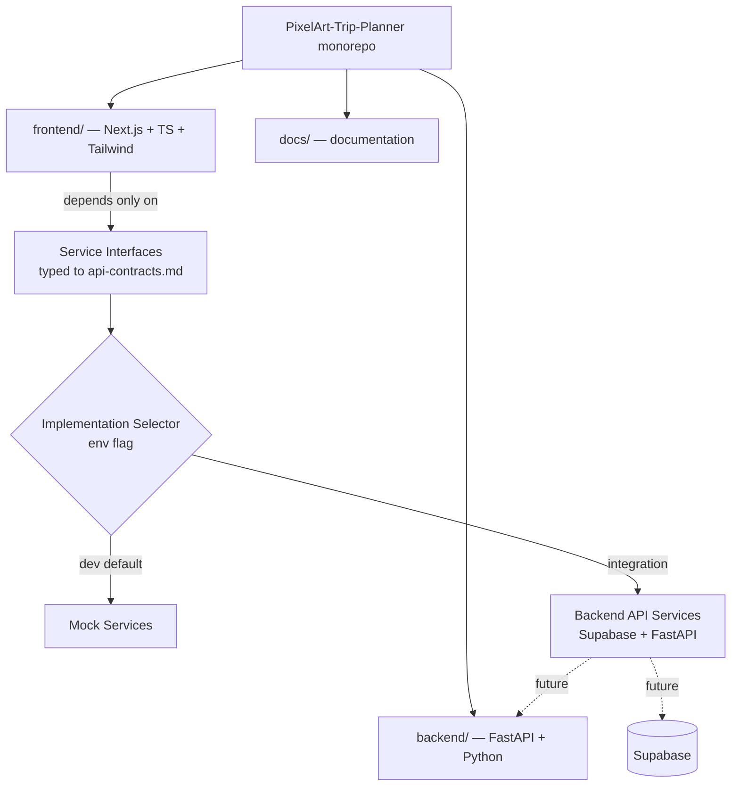
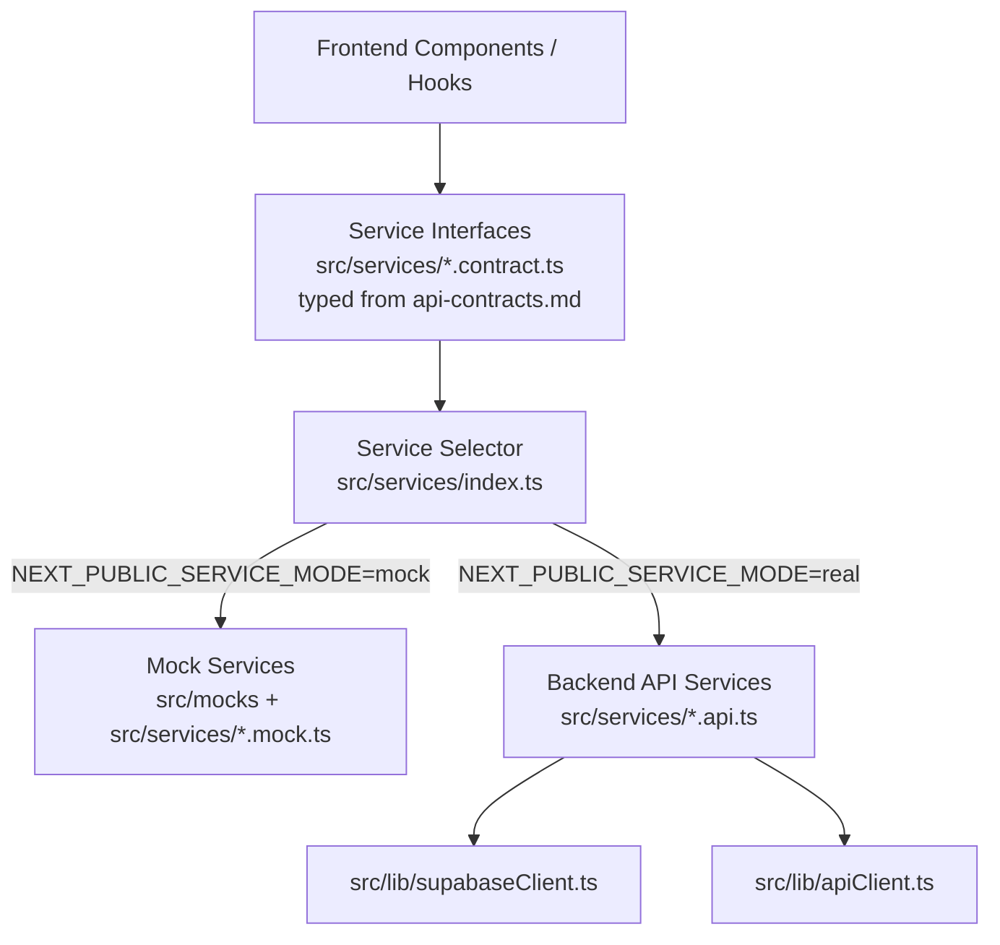
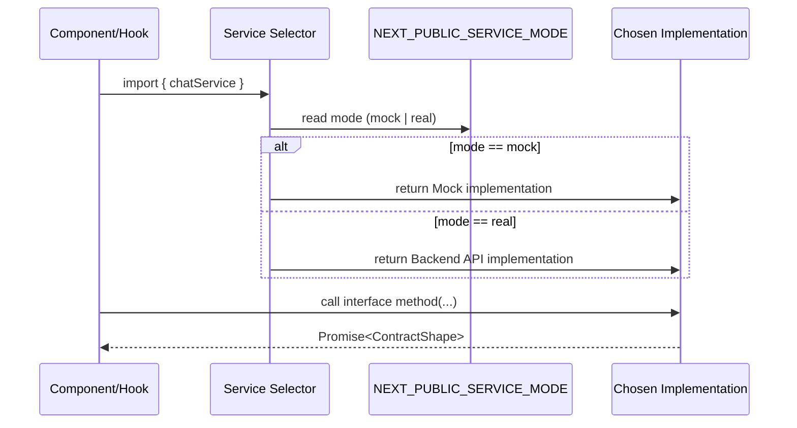
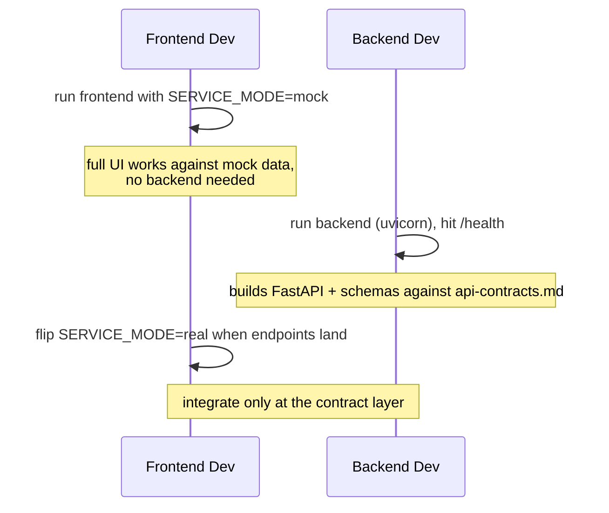

# Design Document: Project Foundation

## Overview

This feature establishes the initial project foundation and scaffolding for **PixelArt Trip
Planner** so that three team members — one frontend developer and two backend developers — can
work in parallel without blocking each other. It sets up a monorepo with three independently
deployable parts: a **Next.js (App Router) + React + TypeScript + Tailwind** frontend, a
**FastAPI + Python** backend placeholder, and a shared **docs** structure, plus root-level
configuration (README, `.env.example` files).

The defining architectural decision of this foundation is the **contract-first service layer with
a mock/real implementation selector**. Because the frontend and backend are built simultaneously,
the frontend cannot wait on real Supabase/FastAPI endpoints. Instead, the UI depends only on
**service interfaces** whose shapes are dictated by `api-contracts.md` (the single source of
truth). Two implementations of each interface exist behind a single selection point: **mock
services** for independent frontend development, and **backend API services** for integration with
Supabase and FastAPI. Switching from mock to real is a configuration change (an environment flag),
never a UI change.

This is **scaffolding only**. No business logic, no AI orchestration, no real Supabase features,
and no auth are implemented here. Everything below is structure, typed contracts, placeholder
implementations, and the wiring that lets the three developers proceed independently. The no-auth
guest model from `product.md` / `supabase-architecture.md` is respected — there is no auth feature
to scaffold.

---

## Architecture

### Monorepo Layout

```
PixelArt-Trip-Planner/
├── README.md                     # root: what this is, how to run each part
├── .env.example                  # root-level shared/example env (points to per-part examples)
├── .gitignore
├── frontend/                     # Next.js App Router app (independently deployable)
├── backend/                      # FastAPI app placeholder (independently deployable)
└── docs/                         # documentation structure
```

The two runnable parts (`frontend/`, `backend/`) each own their toolchain, dependency manifest,
and deploy target. They share nothing at runtime except the agreed HTTP contract described in
`api-contracts.md`. This keeps them **independently deployable** and lets the three developers move
in parallel.



### Service Layer Boundary (the core of this foundation)

The layering the user specified is the backbone of parallel development:



Rules that fall out of this boundary (aligned with `frontend-architecture.md` and
`development-rules.md`):

- UI (components, hooks) imports **only** the service interface and the selector. It never imports
  a concrete mock or api implementation, and never touches Supabase/FastAPI directly.
- The selector is the **single switch point**. Changing `NEXT_PUBLIC_SERVICE_MODE` from `mock` to
  `real` swaps implementations with zero UI edits.
- All service method signatures and returned shapes are typed from `src/types`, which mirror
  `api-contracts.md`. The contract file remains the source of truth; the TypeScript types are its
  code expression.

### Frontend Internal Structure

Follows `frontend-architecture.md` exactly, with a mocks location added per the user's
mock-inclusive interpretation:

```
frontend/
├── app/                          # App Router routes/layouts (thin, compose features)
│   ├── layout.tsx
│   ├── page.tsx                  # placeholder landing
│   └── globals.css               # Tailwind entry + pixel base
├── src/
│   ├── features/                 # feature modules (empty placeholders: 6 stages + party-room)
│   │   ├── setup/
│   │   ├── party-room/
│   │   ├── discover/
│   │   ├── logistics/
│   │   ├── build/
│   │   ├── refine/
│   │   └── wrap/
│   ├── components/               # shared pixel primitives (placeholder tier)
│   ├── hooks/                    # shared hooks (empty)
│   ├── lib/                      # supabaseClient, apiClient (placeholder clients)
│   ├── services/                 # service interfaces + selector + impl scaffolds
│   ├── mocks/                    # mock data + fixtures used by mock services
│   └── types/                    # shared types mirroring api-contracts.md
├── public/                       # sprite assets bucket-equivalent (placeholder)
├── tailwind.config.ts            # pixel design tokens (source of truth for styling)
├── tsconfig.json                 # strict mode on
├── package.json
├── .env.example                  # NEXT_PUBLIC_SERVICE_MODE, Supabase/API URLs (placeholders)
└── README.md
```

Each `src/features` stage folder maps one-to-one to a user-journey stage (setup, discover,
logistics, build, refine, wrap) plus the shared `party-room`. In the Foundation these are empty
placeholders — folder structure only, no feature or business logic.

### Backend Internal Structure (placeholder)

FastAPI structure with a Python environment setup, owned by the two backend developers. No
LangGraph, no AI, no real endpoints beyond a health check.

```
backend/
├── app/
│   ├── __init__.py
│   ├── main.py                   # FastAPI() app + /health placeholder
│   ├── api/
│   │   ├── __init__.py
│   │   └── routes/
│   │       └── health.py         # GET /health -> {"status": "ok"}
│   ├── core/
│   │   ├── __init__.py
│   │   └── config.py             # settings loaded from env (placeholder)
│   └── schemas/
│       └── __init__.py           # request/response models mirroring api-contracts.md (later)
├── tests/
│   └── test_health.py            # smoke test for the placeholder endpoint
├── pyproject.toml                # or requirements.txt — Python deps + tooling
├── .env.example                  # backend env placeholders (Supabase service key slot, etc.)
└── README.md
```

### Docs Structure

```
docs/
├── README.md                     # index of documentation
├── architecture.md               # links back to .kiro/steering as the canonical source
├── getting-started.md            # how the three devs set up frontend + backend
└── contracts.md                  # points to api-contracts.md as the single source of truth
```

### Supabase Ownership Boundary

Ownership of Supabase is split cleanly between the two runnable parts:

- **Frontend_App** owns Supabase client integration where appropriate, exposing only a
  placeholder **anon-key** client (`src/lib/supabaseClient.ts`) that makes **no network calls** in
  the Foundation. The frontend **never holds the Supabase service key**.
- **Backend_App** owns privileged / **service-role** Supabase operations and all AI-related data
  workflows. Any privileged or AI-related data operation belongs to the backend boundary.
- No real Supabase calls exist on either side in this phase — only placeholders and reserved
  locations.

`api-contracts.md` remains the single source of truth. This aligns with Requirement 13 (Supabase
Ownership Boundary) and `supabase-architecture.md`.

---

## Sequence Diagrams

### Selecting a service implementation at runtime



The UI code path is identical regardless of mode — only the selector's branch differs.

### Independent local run (parallel development)



---

## Components and Interfaces

This foundation defines the **shape** of the service layer, not its behavior. Concrete methods
return placeholder data (mock) or throw "not implemented" (real). Interfaces are grouped by the
domains in `api-contracts.md`.

### Component: Service Interface Layer

**Purpose**: Typed contracts the UI depends on. One interface per contract domain. Signatures are
derived from `api-contracts.md`; shapes come from `src/types`.

**Interfaces** (TypeScript, signatures only — see formal specs later):

```typescript
// src/services/guest.contract.ts
interface GuestService {
  createGuest(input: { displayName: string; avatarUrl?: string }): Promise<Guest>;
  getGuest(guestId: string): Promise<Guest | null>;
}

// src/services/room.contract.ts
interface RoomService {
  createRoom(input: { name: string; ownerId: string }): Promise<PartyRoom>;
  joinRoom(input: { roomId: string; guestId: string; characterId?: string }): Promise<RoomMember>;
  getRoom(roomId: string): Promise<PartyRoom | null>;
  listMembers(roomId: string): Promise<RoomMember[]>;
}

// src/services/chat.contract.ts
interface ChatService {
  sendMessage(input: { roomId: string; senderId: string; text: string }): Promise<Message>;
  listMessages(roomId: string): Promise<Message[]>;
  subscribe(roomId: string, onMessage: (m: Message) => void): Unsubscribe;
}

// src/services/vote.contract.ts
interface VoteService {
  castVote(input: { voteSessionId: string; optionId: string; guestId: string }): Promise<void>;
  getSession(voteSessionId: string): Promise<VoteSession | null>;
}

// src/services/itinerary.contract.ts
interface ItineraryService {
  getCurrent(tripId: string): Promise<ItineraryVersion | null>;
  listVersions(tripId: string): Promise<ItineraryVersion[]>;
  submitFeedback(input: FeedbackInput): Promise<Feedback>;
  approve(input: { tripId: string; version: number }): Promise<void>;
  export(tripId: string): Promise<ExportPayload>;
}
```

**Responsibilities**:
- Express `api-contracts.md` as typed methods.
- Be the only surface the UI knows about.
- Stay implementation-agnostic (no Supabase/FastAPI types leak through).
- Remain **placeholders**: the interfaces declare method signatures only and contain no
  feature/business logic. Behaviour is provided solely by the Mock implementation
  (contract-shaped fixtures) or the Real placeholder (throws `NotImplementedError`).

### Component: Service Selector

**Purpose**: The single switch that returns either mock or real implementations based on an env
flag. This is the "single selection point" the user requires.

**Interface**:

```typescript
// src/services/index.ts
type ServiceMode = "mock" | "real";

interface ServiceRegistry {
  guest: GuestService;
  room: RoomService;
  chat: ChatService;
  vote: VoteService;
  itinerary: ItineraryService;
}

function getServices(): ServiceRegistry; // reads NEXT_PUBLIC_SERVICE_MODE
```

**Responsibilities**:
- Read `NEXT_PUBLIC_SERVICE_MODE` (default `mock`).
- Return a fully-populated `ServiceRegistry` for the selected mode.
- Guarantee that both modes satisfy the identical interfaces.

### Component: Mock Services

**Purpose**: In-memory implementations returning fixture data so the frontend runs with no
backend. Live in `src/services/*.mock.ts` backed by fixtures in `src/mocks/`.

**Responsibilities**:
- Implement every interface method with deterministic placeholder data.
- Simulate realtime (`subscribe`) with local emitters where needed.
- Never contain business logic beyond what is needed to return contract-shaped data.

### Component: Backend API Services (placeholder)

**Purpose**: Real implementations that will call Supabase (`src/lib/supabaseClient.ts`) and FastAPI
(`src/lib/apiClient.ts`). In this foundation they are scaffolds that throw `NotImplementedError`.

**Responsibilities**:
- Hold the shape of the real integration without implementing it.
- Isolate all Supabase/FastAPI calls to this layer (per `frontend-architecture.md`).

### Component: Pixel Design Token Foundation

**Purpose**: Establish Tailwind theme tokens per `pixel-design-system.md` so styling is consistent
from day one. No real primitives are implemented — only tokens and optional placeholder shells.

**Responsibilities**:
- Define named color roles (`bg`, `bg-alt`, `ink`, `primary`, `primary-dark`, `accent`, `success`,
  `warning`, `danger`, `muted`), the 8px spacing scale, pixel fonts, and `image-rendering:
  pixelated` support in `tailwind.config.ts`.
- Provide placeholder primitive files in `src/components` (e.g. `PixelButton`, `PixelCard`,
  `DialogueBox`) as typed shells to be filled later — never re-implemented per feature.

### Component: Backend App Placeholder

**Purpose**: A minimal FastAPI app the backend devs extend. Exposes only `/health`.

**Interface** (Python):

```python
# app/api/routes/health.py
@router.get("/health")
def health() -> dict[str, str]:
    ...
```

**Responsibilities**:
- Boot a FastAPI app with config loaded from env.
- Provide a health endpoint and a smoke test.
- Reserve `app/schemas` for models mirroring `api-contracts.md` (added later).

---

## Data Models

Types live in `src/types` and mirror `api-contracts.md`. **`api-contracts.md` remains the single
source of truth**; these are its TypeScript expression. Shown as shapes, not behavior.

```typescript
// src/types/guest.ts
interface Guest {
  id: string;              // client-generated UUID
  displayName: string;
  avatarUrl?: string;
}

// src/types/room.ts
type PlanningStage = "setup" | "discover" | "logistics" | "build" | "refine" | "wrap";

interface PartyRoom {
  id: string;
  name: string;
  ownerId: string;
  status: string;
  planningStage: PlanningStage;
}

interface RoomMember {
  id: string;
  roomId: string;
  guestId: string;
  characterId?: string;
  role: string;
}

// src/types/message.ts
type SenderType = "user" | "ai";
type MessageKind = "text" | "recommendation" | "vote" | "summary";

interface Message {
  id: string;
  roomId: string;
  createdAt: string;       // ISO 8601
  senderType: SenderType;
  senderId: string | null; // null for AI
  kind: MessageKind;
  content: unknown;        // shape depends on kind (see api-contracts.md)
}

// src/types/vote.ts
interface VoteOption { id: string; label: string; count: number; }
interface VoteSession {
  voteSessionId: string;
  roomId: string;
  question: string;
  options: VoteOption[];
  status: "open" | "closed";
}

// src/types/itinerary.ts
interface ItineraryItem { time?: string; title: string; description?: string; location?: string; tags?: string[]; }
interface ItineraryDay { day: number; date?: string; items: ItineraryItem[]; }
interface Itinerary {
  tripId: string;
  roomId: string;
  title: string;
  summary: string;
  destination: { name: string; country?: string };
  dates?: { start: string; end: string };
  days: ItineraryDay[];
  map?: { label: string; lat: number; lng: number }[];
}
interface ItineraryVersion {
  version: number;
  source: "build" | "refine";
  isCurrent: boolean;
  itinerary: Itinerary;
  changeSummary?: string;
}

// src/types/feedback.ts
interface FeedbackInput { tripId: string; version: number; target: string; comment: string; }
interface Feedback extends FeedbackInput { id: string; status: "open" | "addressed"; }

// src/types/export.ts
interface ExportPayload { tripId: string; shareable: unknown; }
```

**Validation Rules**:
- All ids are UUID strings; timestamps are ISO 8601 strings (per `api-contracts.md`).
- Types are structural mirrors of the contract; any change starts in `api-contracts.md` first.
- `strict` TypeScript; no `any` — use `unknown` for kind-dependent `content`.

---

## Algorithmic Pseudocode

The only non-trivial logic in this foundation is the implementation selector. Everything else is
scaffolding.

### Service selection

```pascal
ALGORITHM getServices()
INPUT: none (reads environment)
OUTPUT: registry of type ServiceRegistry

BEGIN
  mode ← readEnv("NEXT_PUBLIC_SERVICE_MODE")

  IF mode = NULL OR mode = "" THEN
    mode ← "mock"                       // safe default for parallel dev
  END IF

  IF mode = "mock" THEN
    registry ← buildMockRegistry()
  ELSE IF mode = "real" THEN
    registry ← buildRealRegistry()
  ELSE
    RAISE ConfigError("Unknown NEXT_PUBLIC_SERVICE_MODE: " + mode)
  END IF

  ASSERT registry satisfies ServiceRegistry   // both modes share one interface set
  RETURN registry
END
```

**Preconditions:**
- The environment may or may not define `NEXT_PUBLIC_SERVICE_MODE`.
- `buildMockRegistry` and `buildRealRegistry` each produce every service in `ServiceRegistry`.

**Postconditions:**
- Returns a registry whose members satisfy the shared interfaces.
- Unknown modes fail loudly (no silent fallback to a wrong implementation).
- No UI code observes which mode was chosen.

**Loop Invariants:** N/A (no loops).

### Backend health placeholder

```pascal
ALGORITHM health()
INPUT: none
OUTPUT: object { status }

BEGIN
  RETURN { status: "ok" }
END
```

**Preconditions:** FastAPI app has started.
**Postconditions:** Returns a fixed OK payload; no side effects; used as a deploy/smoke check.
**Loop Invariants:** N/A.

---

## Key Functions with Formal Specifications

### `getServices(): ServiceRegistry`

**Preconditions:**
- Reads `NEXT_PUBLIC_SERVICE_MODE`; absence is allowed (treated as `mock`).

**Postconditions:**
- Returns a complete `ServiceRegistry` for the selected mode.
- Throws on an unrecognized mode value.
- The returned object is interchangeable across modes from the UI's perspective (same interface).

**Loop Invariants:** N/A.

### `createGuest(input): Promise<Guest>` (interface-level spec, both impls)

**Preconditions:**
- `input.displayName` is a non-empty string (guest model requires a display name).

**Postconditions:**
- Mock: resolves to a `Guest` with a generated UUID `id` and the given `displayName`.
- Real (placeholder): rejects with `NotImplementedError`.
- No passwords/email/tokens involved (no-auth guest model).

**Loop Invariants:** N/A.

### `subscribe(roomId, onMessage): Unsubscribe` (interface-level spec)

**Preconditions:**
- `roomId` is a non-empty string; `onMessage` is callable.

**Postconditions:**
- Mock: returns an unsubscribe function; may emit fixture messages locally.
- Real (placeholder): rejects/throws `NotImplementedError` until Supabase Realtime is wired.
- Calling the returned function stops further callbacks (idempotent).

**Loop Invariants:** N/A.

---

## Example Usage

### Frontend consumes services without knowing the mode

```typescript
// A feature hook — identical whether mock or real is active
import { getServices } from "@/services";

async function loadRoom(roomId: string) {
  const { room } = getServices();
  const [details, members] = await Promise.all([
    room.getRoom(roomId),
    room.listMembers(roomId),
  ]);
  return { details, members }; // shapes are guaranteed by the contract types
}
```

### Flipping to the real backend (no UI change)

```bash
# frontend/.env.local
# development default:
NEXT_PUBLIC_SERVICE_MODE=mock
# integration — flip this one flag, rebuild, no component edits:
# NEXT_PUBLIC_SERVICE_MODE=real
```

### Backend placeholder run

```python
# app/main.py
from fastapi import FastAPI
from app.api.routes import health

app = FastAPI(title="PixelArt Trip Planner API")
app.include_router(health.router)
# uvicorn app.main:app --reload  ->  GET /health -> {"status": "ok"}
```

---

## Correctness Properties

### Property 1: Single switch point

**Validates: Requirements 6.7, 7.6**

For every service consumed by the UI, the concrete implementation is chosen only inside
`getServices()`. ∀ UI import: it references the interface/selector, never a `*.mock.ts` or
`*.api.ts` file directly.

### Property 2: Interface parity

**Validates: Requirements 5.1, 6.6**

∀ service S in `ServiceRegistry`: the mock and real implementations both satisfy the identical
interface type of S (verified by the TypeScript compiler).

### Property 3: Contract fidelity

**Validates: Requirements 5.3, 5.4, 5.5**

∀ type T in `src/types`: T's shape matches the corresponding shape in `api-contracts.md`. The
contract file is authoritative; types are derived from it.

### Property 4: Mode swap is UI-invariant

**Validates: Requirements 7.7**

Changing `NEXT_PUBLIC_SERVICE_MODE` from `mock` to `real` requires zero edits to files under
`app/` or `src/features` or `src/components`.

### Property 5: Independent deployability

**Validates: Requirements 8.1, 8.3**

The frontend builds and runs with `mode=mock` and no backend reachable; the backend builds and
serves `/health` with no frontend present.

### Property 6: No forbidden scaffolding

**Validates: Requirements 10.1, 10.2, 10.3, 10.4**

No auth flows, no AI/LangGraph code, and no real Supabase feature calls exist in the foundation
(only placeholder clients and `NotImplementedError` stubs).

---

## Error Handling

### Unknown service mode

**Condition**: `NEXT_PUBLIC_SERVICE_MODE` is set to something other than `mock`/`real`.
**Response**: `getServices()` throws a `ConfigError` at startup.
**Recovery**: Developer corrects the env value; fail-fast prevents silently running the wrong impl.

### Real service called before implementation exists

**Condition**: `mode=real` but an endpoint isn't implemented yet.
**Response**: The placeholder method throws/rejects with `NotImplementedError`.
**Recovery**: Surface as an explicit error state in the UI (no silent failure, per
`development-rules.md`); fall back to `mode=mock` for continued frontend work.

### Missing environment configuration

**Condition**: Frontend or backend started without required env values.
**Response**: Frontend defaults service mode to `mock`; backend `config.py` surfaces a clear
startup error for any required-but-missing value.
**Recovery**: Copy `.env.example` to a local env file and fill placeholders.

---

## Testing Strategy

### Unit Testing Approach

- **Selector**: verify `getServices()` returns mock by default, real when flagged, and throws on an
  unknown mode (this is the one piece of real logic in the foundation).
- **Mock services**: verify each method returns contract-shaped fixture data.
- Keep tests minimal and non-speculative per `development-rules.md` — cover the selector and a
  smoke test per layer, nothing more at foundation stage.

### Property-Based Testing Approach

Not warranted for pure scaffolding. Reserve property tests for later features with real logic
(e.g. vote resolution, refinement). **Property Test Library** (when introduced): `fast-check`
(frontend) / `hypothesis` (backend).

### Integration Testing Approach

- **Backend**: `tests/test_health.py` asserts `GET /health` returns `{"status": "ok"}` — doubles as
  a deploy smoke test.
- **Cross-part**: deferred until real service implementations land; the contract types are the
  integration guarantee in the meantime.

### Test frameworks

- Frontend: Vitest + React Testing Library (agree and pin once established). Run single-shot
  (`vitest --run`) rather than watch mode.
- Backend: pytest.

---

## Performance Considerations

Not a concern for scaffolding. One note: the mock realtime `subscribe` should use lightweight local
emitters so the mocked UI stays responsive and doesn't leak timers (unsubscribe must clean up).

---

## Security Considerations

- **No auth by design.** Guest identity is a display name plus a client-generated UUID
  (`product.md`, `supabase-architecture.md`). Do not scaffold auth screens, tokens, or password
  handling.
- **Secrets stay out of git.** Only `.env.example` files with placeholders are committed; real
  `.env*` files are git-ignored. The Supabase service key belongs to the backend/service role only,
  never the frontend anon client.
- **No sensitive data.** Guests provide only a display name; do not add fields that collect PII.
- RLS/trust-model details are out of scope for the foundation and remain documented in
  `supabase-architecture.md` for when real Supabase features are added.

---

## Dependencies

**Frontend**
- `next`, `react`, `react-dom`, `typescript`
- `tailwindcss`, `postcss`, `autoprefixer`
- `@supabase/supabase-js` (placeholder client only; not exercised yet)
- Dev/test: `vitest`, `@testing-library/react`, ESLint + Prettier

**Backend**
- `fastapi`, `uvicorn`, `pydantic`, `pydantic-settings`
- Dev/test: `pytest`
- (LangGraph and AI/external-API deps intentionally **excluded** at foundation stage.)

**Tooling / repo**
- Root `.gitignore`, per-part `.env.example`, `docs/` structure.

---

## Steering Reconciliation Note (design consideration → follow-up task)

The user's authoritative interpretation for this spec is **mock-inclusive**: the frontend develops
against mock services that implement the same interfaces as the real backend services, switchable
via a single env flag. Earlier edits to `development-rules.md` and `frontend-architecture.md`
removed mentions of mocks, so those two steering files should be **reconciled** to this
interpretation:

- `frontend-architecture.md` — restore/clarify that the service layer has two interchangeable
  implementations (mock + real) selected at one point, and document the `src/mocks` location.
- `development-rules.md` — clarify that mock services are the initial development path and must
  satisfy the same interfaces as the real implementations.

**`api-contracts.md` stays the single source of truth** for all data shapes and is *not* changed by
this reconciliation. This is captured here as a design consideration and will be carried into the
tasks phase as an explicit follow-up task (documentation/steering update, not code).
