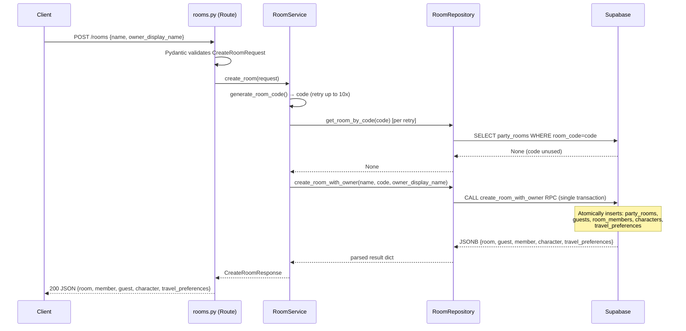
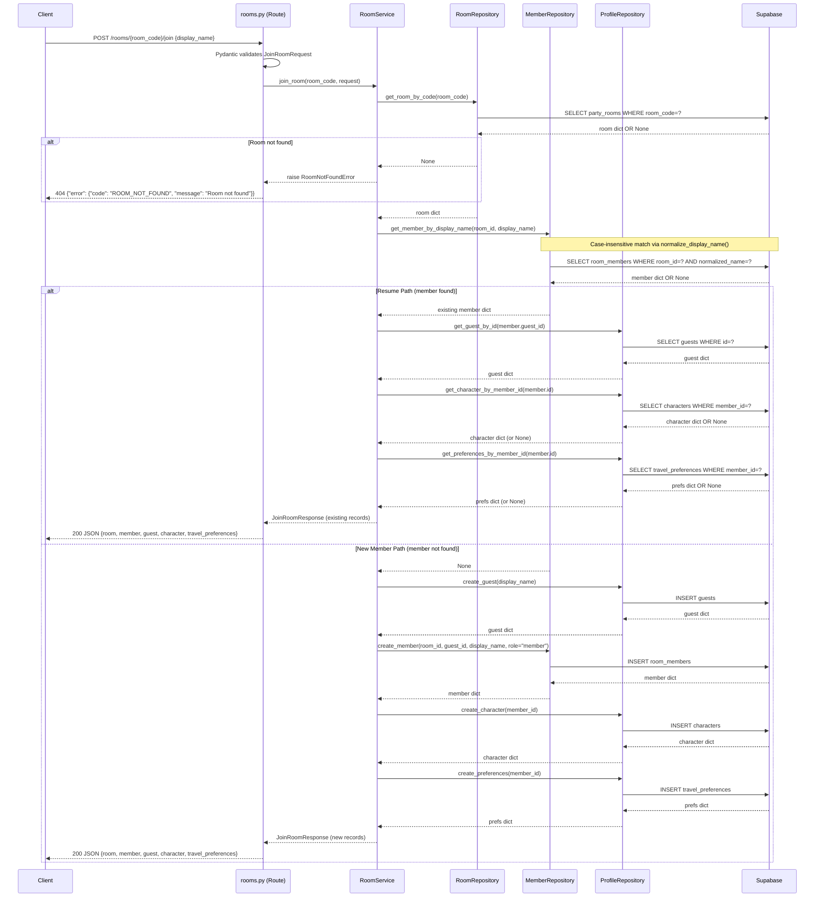

# Design Document: Backend Core (02-backend-core)

## Overview

This document describes the technical design for the PixelArt Trip Planner backend core.
It implements the two room-management endpoints (`POST /rooms` and
`POST /rooms/{room_code}/join`) that allow a party to form and carry the full guest-identity
model defined in `supabase-architecture.md` and `api-contracts.md`.

The design follows a strict three-layer architecture (routes → services → repositories),
wires all dependencies through FastAPI's `Depends()` mechanism, and keeps Supabase access
isolated to the repository layer. Domain exceptions provide a clean boundary between
backend internals and HTTP error shapes so nothing sensitive ever escapes to a response
body.

Room creation is atomic via a PostgreSQL RPC function — either all five records are
created or none are. Identity is room-scoped and case-insensitive:
`room_id + normalized display_name` → `room_member`, so `"Gerald"`, `"gerald"`, and
`"GERald"` are the same member.

---

## Architecture

### Component Diagram

```mermaid
graph TD
    subgraph "HTTP Layer"
        R[POST /rooms<br/>POST /rooms/{code}/join<br/>app/api/routes/rooms.py]
    end

    subgraph "Service Layer"
        RS[RoomService<br/>app/services/room_service.py]
        GEN[generate_room_code]
    end

    subgraph "Repository Layer"
        RR[RoomRepository<br/>app/repositories/room_repository.py]
        MR[MemberRepository<br/>app/repositories/member_repository.py]
        PR[ProfileRepository<br/>app/repositories/profile_repository.py]
    end

    subgraph "Infrastructure"
        SC[AsyncClient factory<br/>app/db/supabase_client.py<br/>injected via app/api/deps.py]
        DB[(Supabase / PostgreSQL)]
    end

    R -->|Depends| RS
    RS -->|Depends| RR
    RS -->|Depends| MR
    RS -->|Depends| PR
    RS --> GEN

    RR -->|Depends| SC
    MR -->|Depends| SC
    PR -->|Depends| SC

    SC --> DB
```

### Layer Responsibilities

| Layer | Location | Responsibility |
|---|---|---|
| Route | `app/api/routes/rooms.py` | Parse HTTP, validate shapes via Pydantic, delegate to service, map domain exceptions to HTTP status |
| Service | `app/services/room_service.py` | Business logic: room code generation, member identity resolution, record-creation orchestration |
| Repository | `app/repositories/` | All Supabase calls; wraps Supabase errors into `RepositoryError` |
| Dependency wiring | `app/api/deps.py` | FastAPI dependency functions (`get_supabase_client()`, repository and service providers) exposed through `Depends()` |
| Infra | `app/db/supabase_client.py` | Low-level factory `create_supabase_client()` that creates the `AsyncClient` |

### Repository Design Principle

Repository boundaries follow business domains, not individual database tables. A new
repository is only introduced when: (1) the domain contains significant business logic,
(2) multiple services depend on the same data access pattern, or (3) separation improves
maintainability.

The three domain repositories are:
- **RoomRepository** — room creation (via RPC transaction), room lookup
- **MemberRepository** — room member CRUD and case-insensitive identity lookup
- **ProfileRepository** — guest profiles, characters, and travel preferences (the
  three tables are always accessed together as a unit)

---

### Architecture Rule (persistent across specs)

> The backend owns all business decisions, all database writes, and all validation and error translation. The frontend may read realtime state using the Supabase anon key and may subscribe to live updates; it may not perform business-logic mutations directly against Supabase. All error responses from the backend conform to the `API_Error_Response` envelope: `{"error": {"code": "...", "message": "..."}}`.

This rule applies to all current and future specs in this project and is enforced by:
1. The layered architecture (Route → Service → Repository → Supabase)
2. The `Access_Boundary` principle (Requirement 23)
3. The standardized error envelope (Requirement 22)

---

## Sequence Diagrams

### POST /rooms (happy path)



### POST /rooms/{room_code}/join — both paths



---

## Components and Interfaces

### `app/db/supabase_client.py`

```python
from supabase import AsyncClient, acreate_client
from app.core.config import get_settings

async def create_supabase_client() -> AsyncClient:
    """Low-level factory: create an initialized async Supabase client."""
    settings = get_settings()
    client = await acreate_client(
        settings.supabase_url,
        settings.supabase_service_role_key,
    )
    return client
```

This module is responsible only for creating the `AsyncClient`; it defines no FastAPI
dependencies. The FastAPI dependency wrapper `get_supabase_client()` lives in
`app/api/deps.py`, calls `create_supabase_client()`, and is consumed via
`Depends(get_supabase_client)` (see Dependency Injection Wiring). A new client is created
per request; Supabase's `AsyncClient` is stateless enough for this pattern.

---

### `app/exceptions.py` and `app/schemas/errors.py`

**Domain exceptions** (`app/exceptions.py`):

```python
class BackendError(Exception):           # base for all domain errors
class RoomNotFoundError(BackendError):   # → HTTP 404, code "ROOM_NOT_FOUND"
class MemberAlreadyExistsError(BackendError):  # → HTTP 409, code "MEMBER_ALREADY_EXISTS"
class InvalidDisplayNameError(BackendError):   # → HTTP 422, code "INVALID_DISPLAY_NAME"
class RepositoryError(BackendError):     # → HTTP 503, code "DATABASE_ERROR"
class RoomCodeExhaustedError(BackendError):    # → HTTP 500, code "ROOM_CODE_EXHAUSTED"
class ValidationError(BackendError):     # → HTTP 422, code "VALIDATION_ERROR"
```

**Standardized error response schema** (`app/schemas/errors.py`):

```python
from pydantic import BaseModel

class ErrorDetail(BaseModel):
    code: str      # machine-readable uppercase string, e.g. "ROOM_NOT_FOUND"
    message: str   # human-readable, safe for display

class ErrorResponse(BaseModel):
    error: ErrorDetail
```

This schema is included in the OpenAPI output so frontend developers see the error shape in `/docs`.

**Error code mapping** (used by all exception handlers in `app/main.py`):

| Exception class | HTTP status | `code` value |
|---|---|---|
| `RoomNotFoundError` | 404 | `"ROOM_NOT_FOUND"` |
| `MemberAlreadyExistsError` | 409 | `"MEMBER_ALREADY_EXISTS"` |
| `InvalidDisplayNameError` | 422 | `"INVALID_DISPLAY_NAME"` |
| `ValidationError` | 422 | `"VALIDATION_ERROR"` |
| `RepositoryError` | 503 | `"DATABASE_ERROR"` |
| `RoomCodeExhaustedError` | 500 | `"ROOM_CODE_EXHAUSTED"` |
| `RequestValidationError` (Pydantic) | 422 | `"VALIDATION_ERROR"` |
| Any other `Exception` | 500 | `"INTERNAL_ERROR"` |

All exception handlers carry this same shape. The `Service_Role_Key`, raw Supabase payloads, and stack traces must never appear in the `message` field.

---

### `app/core/config.py` — extended Settings

```python
class Settings(BaseSettings):
    app_name: str = "PixelArt Trip Planner API"
    environment: str = "development"

    # Required: fail fast if absent or blank
    supabase_url: str           # validated as URL by custom validator
    supabase_service_role_key: str  # never logged, never returned in responses

    # CORS
    frontend_url: str = Field(default="http://localhost:3000")

    @field_validator("supabase_url")
    @classmethod
    def validate_url(cls, v: str) -> str:
        from urllib.parse import urlparse
        parsed = urlparse(v)
        if not parsed.scheme or not parsed.netloc:
            raise ValueError("SUPABASE_URL must be a valid URL with scheme and host")
        return v
```

The `supabase_service_role_key` field has no `repr` so it is omitted from `str(settings)`,
protecting it from accidental logging.

---

### `app/main.py` — CORS middleware and exception handlers

```python
import logging
from fastapi.middleware.cors import CORSMiddleware
from fastapi.exceptions import RequestValidationError
from app.schemas.errors import ErrorDetail, ErrorResponse

logger = logging.getLogger(__name__)

# Helper used by all handlers
def _err(code: str, message: str) -> dict:
    return ErrorResponse(error=ErrorDetail(code=code, message=message)).model_dump()

settings = get_settings()

app.add_middleware(
    CORSMiddleware,
    allow_origins=[settings.frontend_url],
    allow_credentials=True,
    allow_methods=["*"],
    allow_headers=["*"],
)

@app.exception_handler(RoomNotFoundError)
async def room_not_found_handler(request, exc):
    return JSONResponse(status_code=404, content=_err("ROOM_NOT_FOUND", str(exc)))

@app.exception_handler(MemberAlreadyExistsError)
async def member_conflict_handler(request, exc):
    return JSONResponse(status_code=409, content=_err("MEMBER_ALREADY_EXISTS", str(exc)))

@app.exception_handler(InvalidDisplayNameError)
async def invalid_name_handler(request, exc):
    return JSONResponse(status_code=422, content=_err("INVALID_DISPLAY_NAME", str(exc)))

@app.exception_handler(RepositoryError)
async def repo_error_handler(request, exc):
    # Details stay in internal logs only; the response carries a fixed safe message.
    logger.error("Repository error", exc_info=exc)
    return JSONResponse(
        status_code=503,
        content=_err("DATABASE_ERROR", "Database operation failed."),
    )

@app.exception_handler(RoomCodeExhaustedError)
async def code_exhausted_handler(request, exc):
    return JSONResponse(status_code=500, content=_err("ROOM_CODE_EXHAUSTED", str(exc)))

@app.exception_handler(RequestValidationError)
async def validation_error_handler(request, exc):
    # Override FastAPI's default {"detail": [...]} with the standard envelope
    fields = ", ".join(str(e["loc"]) for e in exc.errors())
    return JSONResponse(status_code=422, content=_err("VALIDATION_ERROR", f"Validation failed: {fields}"))

@app.exception_handler(Exception)
async def catch_all_handler(request, exc):
    return JSONResponse(status_code=500, content=_err("INTERNAL_ERROR", "An internal error occurred."))
```

The `RepositoryError` handler never uses `str(exc)` or any other raw exception message:
raw Supabase payloads, database error details, SQL, stack traces, constraint names, and
internal identifiers never appear in API responses. Only safe, developer-authored messages
reach the response; detailed exception information is kept in internal logs only.

`FRONTEND_URL=http://localhost:3000` is added to `backend/.env.example` so developers
know the variable exists and its expected format.

---

### `app/repositories/base.py`

```python
class BaseRepository:
    def __init__(self, client: AsyncClient) -> None:
        self._client = client

    def _handle_error(self, exc: Exception, operation: str, table: str) -> Never:
        """Wrap any Supabase exception into a RepositoryError with a safe message."""
        raise RepositoryError(
            f"Database operation '{operation}' on '{table}' failed."
        ) from exc
```

All three repositories extend `BaseRepository` and call `self._handle_error()` inside
`except` blocks, keeping error wrapping DRY and consistent. The `RepositoryError` message
(which names the operation and table) is for internal logs only; the `RepositoryError`
handler in `app/main.py` returns the fixed message `"Database operation failed."`.

---

### `app/repositories/room_repository.py`

```python
class RoomRepository(BaseRepository):
    async def create_room_with_owner(
        self,
        name: str,
        room_code: str,
        owner_display_name: str,
        appearance: dict | None = None,
    ) -> dict:
        """Invoke the create_room_with_owner RPC and return the parsed result dict."""
        ...

    async def get_room_by_code(self, room_code: str) -> dict | None: ...
    async def get_room_by_id(self, room_id: str) -> dict | None: ...
```

`create_room_with_owner` invokes the PostgreSQL RPC function of the same name and returns
a dict with keys `room`, `guest`, `member`, `character`, and `travel_preferences`. Input
guards raise `ValidationError` for name violations or `room_code` not matching
`^[A-Z0-9]{4,12}$`. If the RPC returns an error, `RepositoryError` is raised without
including Supabase-internal fields.

---

### `app/repositories/member_repository.py`

```python
class MemberRepository(BaseRepository):
    async def create_member(
        self,
        room_id: str,
        guest_id: str,
        display_name: str,
        role: Literal["owner", "member"],
    ) -> dict: ...

    async def get_member_by_display_name(
        self, room_id: str, display_name: str
    ) -> dict | None:
        """Case-insensitive match on normalized_name within the given room."""
        ...

    async def get_member_by_id(self, member_id: str) -> dict | None: ...

    async def list_members_by_room(self, room_id: str) -> list[dict]: ...
```

`get_member_by_display_name` normalizes the given name and queries
`room_members WHERE room_id = ? AND normalized_name = ?`. Callers pass the display name as
received; normalization happens only here. Uniqueness violations from Postgres (`23505`,
from `UNIQUE(room_id, normalized_name)`) are caught and re-raised as
`MemberAlreadyExistsError`.

The module also defines the normalization helper, which must produce the same value as the
database's generated `normalized_name` column
(`lower(btrim(regexp_replace(display_name, '\s+', ' ', 'g')))`):

```python
def normalize_display_name(name: str) -> str:
    """Trim, collapse internal whitespace to one space, and lower-case."""
    return " ".join(name.split()).lower()
```

**Identity limitation:** This is an MVP convenience model, not authentication. Anyone who
knows the room code and a member's display name (in any casing) can resume that member.
`"Gerald"`, `"gerald"`, and `"GERald"` are the same member; the response returns the
`display_name` as it was first stored.

---

### `app/repositories/profile_repository.py`

```python
class ProfileRepository(BaseRepository):
    async def create_guest(
        self,
        display_name: str,
        avatar_url: str | None = None,
    ) -> dict: ...

    async def get_guest_by_id(self, guest_id: str) -> dict | None: ...

    async def create_character(
        self,
        member_id: str,
        appearance: dict | None = None,
    ) -> dict: ...

    async def get_character_by_member_id(self, member_id: str) -> dict | None: ...

    async def create_preferences(
        self,
        member_id: str,
        available_dates: list | None = None,
        destinations: list | None = None,
        interests: list | None = None,
        activities: list | None = None,
        hard_constraints: list | None = None,
    ) -> dict: ...

    async def get_preferences_by_member_id(self, member_id: str) -> dict | None: ...
```

Input guards raise `ValidationError` before any DB call for:
- `display_name` empty, whitespace-only, or > 50 chars
- Any UUID argument not matching UUID format

---

### `app/services/room_service.py`

```python
class RoomService:
    def __init__(
        self,
        room_repo: RoomRepository,
        member_repo: MemberRepository,
        profile_repo: ProfileRepository,
    ) -> None: ...

    async def create_room(self, request: CreateRoomRequest) -> CreateRoomResponse: ...
    async def join_room(
        self, room_code: str, request: JoinRoomRequest
    ) -> JoinRoomResponse: ...
```

Utility function (module-level):

```python
def generate_room_code(length: int = 6) -> str:
    """Return a random room code of uppercase alphanumeric characters."""
```

---

### `app/api/routes/rooms.py`

```python
router = APIRouter(prefix="/rooms", tags=["rooms"])

@router.post(
    "",
    response_model=CreateRoomResponse,
    summary="Create a new party room",
    description="Creates a new planning room and owner membership in a single atomic transaction.",
    responses={422: {"description": "Validation error"}, 500: {"description": "Internal error"}},
)
async def create_room(
    body: CreateRoomRequest,
    service: RoomService = Depends(get_room_service),
) -> CreateRoomResponse:
    """Create a new party room with the caller as the room owner."""
    ...

@router.post(
    "/{room_code}/join",
    response_model=JoinRoomResponse,
    summary="Join or resume a party room",
    description=(
        "Joins an existing room. If the display name already exists in the room "
        "(ignoring case and surrounding spaces), the existing member is resumed. "
        "Otherwise a new member is created."
    ),
    responses={
        404: {"description": "Room not found"},
        409: {"description": "Concurrent join conflict"},
        422: {"description": "Validation error"},
    },
)
async def join_room(
    room_code: Annotated[str, Path(pattern=r"^[A-Z0-9]{4,12}$")],
    body: JoinRoomRequest,
    service: RoomService = Depends(get_room_service),
) -> JoinRoomResponse:
    """Join a room by room code and display name, or resume an existing member."""
    ...
```

The `room_code` path parameter uses `Annotated[str, Path(pattern=...)]` so FastAPI rejects
non-conforming codes with 422 before the service is ever called.

---

### OpenAPI Documentation

All routes use `summary=`, `description=`, and `responses=` parameters on their
decorators. Request/response schemas annotate every field with `Field(examples=[...])` so
the interactive `/docs` UI shows concrete example values without requiring Dev A to read
implementation code.

Example field annotations:

```python
class CreateRoomRequest(_Base):
    name: _non_empty_str = Field(
        min_length=1, max_length=100,
        examples=["Adventure Club Trip 2025"]
    )
    owner_display_name: _non_empty_str = Field(
        min_length=1, max_length=50,
        examples=["Gerald"]
    )

class JoinRoomRequest(_Base):
    display_name: _non_empty_str = Field(
        min_length=1, max_length=50,
        examples=["Priya"]
    )
```

Response schemas (`PartyRoomSchema`, `RoomMemberSchema`, `GuestSchema`, `CharacterSchema`,
`TravelPreferencesSchema`) each carry `model_config` with `json_schema_extra` providing
at least one example object. This populates the OpenAPI schema so `GET /openapi.json`
includes complete example values for every field.

---

## Schema Migrations

Two migration files manage the database, applied in order:

| File | Purpose |
|---|---|
| `supabase/migrations/20260925000000_initial_schema.sql` | Base schema — all tables, types, indexes, triggers, RLS, and the `normalized_name` generated column with `UNIQUE(room_id, normalized_name)` on `room_members` |
| `supabase/migrations/20260925000002_create_room_rpc.sql` | Defines the `create_room_with_owner` PostgreSQL function |

Both must be applied before any backend endpoint is tested against a real database, so
that the `UNIQUE(room_id, normalized_name)` constraint and the RPC are active.

### `create_room_with_owner` RPC function (Migration 2)

```sql
CREATE OR REPLACE FUNCTION create_room_with_owner(
    p_room_name TEXT,
    p_room_code TEXT,
    p_owner_display_name TEXT,
    p_appearance JSONB DEFAULT '{}'::JSONB
)
RETURNS JSONB
LANGUAGE plpgsql
AS $$
DECLARE
    v_room      party_rooms;
    v_guest     guests;
    v_member    room_members;
    v_character characters;
    v_prefs     travel_preferences;
BEGIN
    INSERT INTO party_rooms(name, room_code, status, planning_stage)
        VALUES (p_room_name, p_room_code, 'active', 'setup')
        RETURNING * INTO v_room;

    INSERT INTO guests(display_name)
        VALUES (p_owner_display_name)
        RETURNING * INTO v_guest;

    INSERT INTO room_members(room_id, guest_id, display_name, role)
        VALUES (v_room.id, v_guest.id, p_owner_display_name, 'owner')
        RETURNING * INTO v_member;

    INSERT INTO characters(member_id, appearance)
        VALUES (v_member.id, p_appearance)
        RETURNING * INTO v_character;

    INSERT INTO travel_preferences(member_id)
        VALUES (v_member.id)
        RETURNING * INTO v_prefs;

    RETURN jsonb_build_object(
        'room',               row_to_json(v_room),
        'guest',              row_to_json(v_guest),
        'member',             row_to_json(v_member),
        'character',          row_to_json(v_character),
        'travel_preferences', row_to_json(v_prefs)
    );
END;
$$;
```

If any insert fails, the entire transaction rolls back and no partial records remain.

---

## Data Models

### Pydantic Schemas (`app/schemas/room.py`)

The API contract in `api-contracts.md` uses camelCase. Pydantic v2 `model_config` with
`populate_by_name=True` and `alias_generator=to_camel` (from `pydantic.alias_generators`)
handles the snake_case ↔ camelCase mapping automatically.

```python
from pydantic import BaseModel, ConfigDict, Field, field_validator
from pydantic.alias_generators import to_camel


class _Base(BaseModel):
    model_config = ConfigDict(
        alias_generator=to_camel,
        populate_by_name=True,
        from_attributes=True,
    )
```

#### Schema ↔ DB Column mapping

| Pydantic field (snake_case) | JSON alias (camelCase) | DB column | Type |
|---|---|---|---|
| `id` | `id` | `id` | UUID → str |
| `room_code` | `roomCode` | `room_code` | str |
| `name` | `name` | `name` | str |
| `status` | `status` | `status` (enum) | Literal |
| `planning_stage` | `planningStage` | `planning_stage` (enum) | Literal |
| `room_id` | `roomId` | `room_id` | UUID → str |
| `guest_id` | `guestId` | `guest_id` | UUID → str |
| `display_name` | `displayName` | `display_name` | str |
| `role` | `role` | `role` (enum) | Literal |
| `member_id` | `memberId` | `member_id` | UUID → str |
| `appearance` | `appearance` | `appearance` | dict |
| `sprite_key` | `spriteKey` | `sprite_key` | str \| None |
| `avatar_url` | `avatarUrl` | `avatar_url` | str \| None |
| `available_dates` | `availableDates` | `available_dates` | list |
| `destinations` | `destinations` | `destinations` | list |
| `travel_style` | `travelStyle` | `travel_style` | str \| None |
| `budget` | `budget` | `budget` | float \| None |
| `interests` | `interests` | `interests` | list |
| `activities` | `activities` | `activities` | list |
| `hard_constraints` | `hardConstraints` | `hard_constraints` | list |

#### Response schemas

```python
class GuestSchema(_Base):
    id: str
    display_name: str = Field(min_length=1, max_length=50)
    avatar_url: str | None = None

class PartyRoomSchema(_Base):
    id: str
    room_code: str
    name: str = Field(max_length=100)
    status: Literal["active", "finalised", "cancelled"]
    planning_stage: Literal["setup", "discover", "logistics", "build", "refine", "wrap"]

class RoomMemberSchema(_Base):
    id: str
    room_id: str
    guest_id: str
    display_name: str = Field(min_length=1, max_length=50)
    role: Literal["owner", "member"]

class CharacterSchema(_Base):
    id: str
    member_id: str
    appearance: dict
    sprite_key: str | None = None

class TravelPreferencesSchema(_Base):
    id: str
    member_id: str
    available_dates: list
    destinations: list
    travel_style: str | None = None
    budget: float | None = Field(default=None, ge=0)
    interests: list
    activities: list
    hard_constraints: list
```

#### Non-whitespace-only validator (reused across request schemas)

```python
def _no_whitespace_only(v: str) -> str:
    if not v.strip():
        raise ValueError("Field must not be empty or whitespace-only")
    return v

_non_empty_str = Annotated[str, AfterValidator(_no_whitespace_only)]
```

#### Request/response schemas

```python
class CreateRoomRequest(_Base):
    name: _non_empty_str = Field(min_length=1, max_length=100, examples=["Adventure Club Trip 2025"])
    owner_display_name: _non_empty_str = Field(min_length=1, max_length=50, examples=["Gerald"])

class JoinRoomRequest(_Base):
    display_name: _non_empty_str = Field(min_length=1, max_length=50, examples=["Priya"])

class _RoomPayload(_Base):
    room: PartyRoomSchema
    member: RoomMemberSchema
    guest: GuestSchema
    character: CharacterSchema
    travel_preferences: TravelPreferencesSchema

class CreateRoomResponse(_RoomPayload): ...
class JoinRoomResponse(_RoomPayload): ...
```

---

## Algorithmic Pseudocode

### `generate_room_code(length=6) -> str`

```
ALPHABET = string.ascii_uppercase + string.digits   # A-Z 0-9

function generate_room_code(length=6):
    return ''.join(secrets.choice(ALPHABET) for _ in range(length))
```

Uses `secrets.choice` (cryptographically random) to avoid predictable sequences.
Length defaults to 6, giving 36^6 ≈ 2.2 billion combinations before collision pressure.

---

### `RoomService.create_room(request) -> CreateRoomResponse`

```
function create_room(request):
    # 1. Generate a unique room code (up to 10 retries)
    code = None
    for attempt in 1..10:
        candidate = generate_room_code()
        existing = await room_repo.get_room_by_code(candidate)
        if existing is None:
            code = candidate
            break
    if code is None:
        raise RoomCodeExhaustedError("Could not generate a unique room code.")

    # 2. Atomic creation via RPC (single DB transaction)
    result = await room_repo.create_room_with_owner(
        name=request.name,
        room_code=code,
        owner_display_name=request.owner_display_name,
        appearance={},
    )
    # result is a dict with keys: room, guest, member, character, travel_preferences

    # 3. Build and return response
    return CreateRoomResponse(
        room=PartyRoomSchema.model_validate(result["room"]),
        member=RoomMemberSchema.model_validate(result["member"]),
        guest=GuestSchema.model_validate(result["guest"]),
        character=CharacterSchema.model_validate(result["character"]),
        travel_preferences=TravelPreferencesSchema.model_validate(result["travel_preferences"]),
    )
```

---

### `RoomService.join_room(room_code, request) -> JoinRoomResponse`

```
function join_room(room_code, request):
    # 1. Resolve room
    room = await room_repo.get_room_by_code(room_code)
    if room is None:
        raise RoomNotFoundError(f"Room '{room_code}' not found.")

    # 2. Check for existing member — case-insensitive match (repo normalizes the name)
    existing_member = await member_repo.get_member_by_display_name(
        room_id=room["id"],
        display_name=request.display_name,   # passed as received
    )

    if existing_member is not None:
        # RESUME PATH: return existing records unchanged
        guest = await profile_repo.get_guest_by_id(existing_member["guest_id"])
        character = await profile_repo.get_character_by_member_id(existing_member["id"])
        prefs = await profile_repo.get_preferences_by_member_id(existing_member["id"])

        return JoinRoomResponse(
            room=PartyRoomSchema.model_validate(room),
            member=RoomMemberSchema.model_validate(existing_member),
            guest=GuestSchema.model_validate(guest),
            character=CharacterSchema.model_validate(character) if character else None,
            travel_preferences=TravelPreferencesSchema.model_validate(prefs) if prefs else None,
        )

    # 3. NEW MEMBER PATH: create all records sequentially
    if not request.display_name.strip():
        raise InvalidDisplayNameError("Display name must not be empty or whitespace-only.")

    guest = await profile_repo.create_guest(display_name=request.display_name)
    member = await member_repo.create_member(
        room_id=room["id"],
        guest_id=guest["id"],
        display_name=request.display_name,
        role="member",
    )
    character = await profile_repo.create_character(member_id=member["id"], appearance={})
    prefs = await profile_repo.create_preferences(member_id=member["id"])

    return JoinRoomResponse(
        room=PartyRoomSchema.model_validate(room),
        member=RoomMemberSchema.model_validate(member),
        guest=GuestSchema.model_validate(guest),
        character=CharacterSchema.model_validate(character),
        travel_preferences=TravelPreferencesSchema.model_validate(prefs),
    )
```

**Design note — join-room is not transactional.** Unlike room creation, the MVP join-room
new member flow does not currently use a database transaction. The sequential repository
calls (`create_guest()` → `create_member()` → `create_character()` →
`create_preferences()`) can theoretically leave partial records if a later insert fails.
The sequential repository calls are acceptable for the current MVP scope. A future
improvement may introduce a PostgreSQL RPC transaction or cleanup strategy if stronger
consistency guarantees are required.

---

### Repository Error Handling Pattern

```
# In each repository method:
try:
    response = await self._client.table(TABLE).insert(data).execute()
    if response.data is None or len(response.data) == 0:
        self._handle_error(
            ValueError("No data returned"), operation="insert", table=TABLE
        )
    return response.data[0]
except RepositoryError:
    raise   # already wrapped, re-raise as-is
except Exception as exc:
    self._handle_error(exc, operation="insert", table=TABLE)
    # _handle_error always raises, never returns
```

For uniqueness violations, detect by inspecting the exception message for `"23505"` (the
PostgreSQL unique constraint violation code) before calling `_handle_error`:

```
except Exception as exc:
    if "23505" in str(exc):
        raise MemberAlreadyExistsError(
            "A member with that name already exists in this room."
        ) from exc
    self._handle_error(exc, operation="create_member", table="room_members")
```

---

## Dependency Injection Wiring

```python
# app/api/deps.py  (shared dependency providers)
from app.db.supabase_client import create_supabase_client

async def get_supabase_client() -> AsyncClient:
    """FastAPI dependency: expose the client from the low-level factory via Depends()."""
    return await create_supabase_client()

def get_room_repo(client: AsyncClient = Depends(get_supabase_client)) -> RoomRepository:
    return RoomRepository(client)

def get_member_repo(client: AsyncClient = Depends(get_supabase_client)) -> MemberRepository:
    return MemberRepository(client)

def get_profile_repo(client: AsyncClient = Depends(get_supabase_client)) -> ProfileRepository:
    return ProfileRepository(client)

def get_room_service(
    room_repo: RoomRepository = Depends(get_room_repo),
    member_repo: MemberRepository = Depends(get_member_repo),
    profile_repo: ProfileRepository = Depends(get_profile_repo),
) -> RoomService:
    return RoomService(room_repo, member_repo, profile_repo)
```

This wiring means:
- Tests can override `get_room_service` (or any individual repo provider) with
  `app.dependency_overrides` without touching anything else.
- The Supabase client is never imported directly in routes or services.

---

## Correctness Properties

*A property is a characteristic or behavior that should hold true across all valid executions of a system — essentially, a formal statement about what the system should do. Properties serve as the bridge between human-readable specifications and machine-verifiable correctness guarantees.*

### Property 1: Normalization matches the identity rule

*For any* valid display name `a`, `normalize_display_name(a)` is idempotent, equals
`normalize_display_name(a.upper())`, `normalize_display_name(a.lower())`, and
`normalize_display_name("  " + a + "  ")`, and contains no leading, trailing, or repeated
whitespace. Names that normalize to the same value resume the same member.

**Validates: Requirements 7.3, 11.4**

---

### Property 2: Same name always resumes the same member

*For any* room and any valid `display_name`, calling `join_room` with that name twice (in
any casing) returns a `JoinRoomResponse` where both responses carry the same `member.id`,
`member.guest_id`, and `member.role`.

**Validates: Requirements 11.1, 11.2, 11.3**

---

### Property 3: Generated room codes always match the required format

*For any* call to `generate_room_code()`, the returned string matches the regular
expression `^[A-Z0-9]{4,12}$`.

Equivalently, every character is in the set `{A-Z, 0-9}`, and the string length is
between 4 and 12 inclusive.

**Validates: Requirements 9.1, 9.4**

---

### Property 4: create_room always creates exactly one owner member per room

*For any* valid `CreateRoomRequest`, after a successful `create_room` call, the returned
`CreateRoomResponse` contains exactly one `member` record with `role == "owner"` and that
`member.room_id` matches the returned `room.id`.

**Validates: Requirements 10.4**

---

### Property 5: Whitespace-only strings are rejected by the non-empty validator

*For any* string `s` composed entirely of whitespace characters (space, tab, newline, etc.),
passing `s` as `name`, `owner_display_name`, or `display_name` in a request schema
raises a Pydantic `ValidationError` identifying the offending field.

**Validates: Requirements 3.13, 12.4**

---

### Property 6: No service-role key value appears in HTTP error responses

*For any* domain exception raised during request processing, the HTTP response body
(serialized as a string) does not contain any substring matching the value of
`SUPABASE_SERVICE_ROLE_KEY` configured in Settings.

**Validates: Requirements 1.6, 18.5**

---

### Property 7: Room creation is atomic

*For any* simulated failure of any single insert inside the `create_room_with_owner` RPC
(party_rooms, guests, room_members, characters, or travel_preferences), after the
transaction rolls back, zero rows exist in any of the five affected tables for that
attempted room code and display name.

This verifies that the RPC transaction leaves no partial records — either all five rows
are present or none are.

**Validates: Requirements 8.3**

---

## Error Handling

### Exception Hierarchy

```
BackendError (base)
├── RoomNotFoundError          → 404
├── MemberAlreadyExistsError   → 409
├── InvalidDisplayNameError    → 422
├── ValidationError            → 422  (raised inside repos, caught in service or route)
├── RepositoryError            → 503  (wraps unexpected Supabase failures)
└── RoomCodeExhaustedError     → 500
```

### Handler Registration

All handlers are registered in `app/main.py` using `@app.exception_handler(ExcType)`.
The catch-all `Exception` handler is registered last and produces a generic 500 response using the `API_Error_Response` envelope with `code: "INTERNAL_ERROR"` and a fixed safe message — never propagating raw exception text.

### Error Response Shape

All error responses conform to the `API_Error_Response` envelope:

```json
{
  "error": {
    "code": "<ERROR_CODE>",
    "message": "<safe human-readable message>"
  }
}
```

The `code` is a machine-readable uppercase string. The `message`:
- Is 1–256 characters
- Contains no Supabase error payloads, constraint names, UUIDs of internal records, or stack traces
- Does not include the service-role key value

Error code mapping:

| Exception / source | HTTP status | `code` |
|---|---|---|
| `RoomNotFoundError` | 404 | `"ROOM_NOT_FOUND"` |
| `MemberAlreadyExistsError` | 409 | `"MEMBER_ALREADY_EXISTS"` |
| `InvalidDisplayNameError` | 422 | `"INVALID_DISPLAY_NAME"` |
| `ValidationError` | 422 | `"VALIDATION_ERROR"` |
| `RequestValidationError` (Pydantic) | 422 | `"VALIDATION_ERROR"` |
| `RepositoryError` | 503 | `"DATABASE_ERROR"` |
| `RoomCodeExhaustedError` | 500 | `"ROOM_CODE_EXHAUSTED"` |
| Any other `Exception` | 500 | `"INTERNAL_ERROR"` |

### Concurrent Join Race Condition

When two requests attempt to create a member with the same display name in the same room
concurrently, the database `UNIQUE (room_id, normalized_name)` constraint ensures only one
INSERT succeeds. The losing request receives a Postgres `23505` error, which
`MemberRepository` converts to `MemberAlreadyExistsError`, which the handler maps to
HTTP 409.

---

## Supabase Access Boundary

FastAPI is the source of truth for all business logic. Supabase provides PostgreSQL storage, Realtime, and backend infrastructure — it does not replace the service layer.

### Mutation rules (must go through FastAPI)

The following operations are backend-only. The frontend MUST call the FastAPI API; direct Supabase writes are prohibited:

| Operation | FastAPI endpoint |
|---|---|
| Create room | `POST /rooms` |
| Join room | `POST /rooms/{room_code}/join` |
| Update preferences | future endpoint |
| Submit vote | future endpoint |
| Generate itinerary | future endpoint |
| Refine itinerary | future endpoint |
| Update planning state | future endpoint |

The `Repository_Layer` is the only code that writes to `party_rooms`, `guests`, `room_members`, `characters`, and `travel_preferences`. No other layer or client writes to these tables.

### Approved direct frontend Supabase access

The frontend MAY use the Supabase anon key directly **only** for:

1. **Realtime subscriptions** — listening to changes on `room_members`, `messages`, `vote_sessions`, `votes`, `selections`, `itinerary_versions`, `feedback`, `party_rooms.planning_stage`, `trips.status`
2. **Non-sensitive reads** — read-only queries on data already in scope for the room context, where no business-logic side-effect is possible

Every direct frontend Supabase access **must be documented** in a comment in the relevant `src/services/*.ts` file stating:
- Which table is accessed
- Why direct access is appropriate (realtime / read-only)
- The expected data shape

### Key rule

The Supabase service-role key stays backend-only. The frontend uses only the anon key. If a new mutation is needed in a future spec, the default is to implement it through FastAPI — direct frontend writes require explicit justification.

---

## Testing Strategy

### Unit Tests (`tests/test_room_service.py`)

Uses `pytest` + `pytest-mock`. All three repositories are mocked via `mocker.AsyncMock`.

**Fixtures:**

```python
@pytest.fixture
def mock_room_repo(mocker): return mocker.AsyncMock(spec=RoomRepository)

@pytest.fixture
def mock_member_repo(mocker): return mocker.AsyncMock(spec=MemberRepository)

@pytest.fixture
def mock_profile_repo(mocker): return mocker.AsyncMock(spec=ProfileRepository)

@pytest.fixture
def room_service(mock_room_repo, mock_member_repo, mock_profile_repo):
    return RoomService(mock_room_repo, mock_member_repo, mock_profile_repo)
```

**Test cases:**

| Test | What it verifies |
|---|---|
| `test_create_room_happy_path` | Returns a `CreateRoomResponse` with all five required fields populated |
| `test_create_room_uses_rpc` | `mock_room_repo.create_room_with_owner` called exactly once; no individual insert methods called |
| `test_join_room_resume_path` | `get_member_by_display_name` returns existing member; `create_guest`, `create_member`, `create_character`, `create_preferences` each called 0 times |
| `test_join_room_new_member_path` | `get_member_by_display_name` returns `None`; `create_guest`, `create_member`, `create_character`, `create_preferences` each called exactly once |
| `test_join_room_room_not_found` | `get_room_by_code` returns `None`; `RoomNotFoundError` raised; no create methods called |
| `test_join_room_passes_name_as_received` | `"GERald"` is passed to `get_member_by_display_name` unchanged (normalization belongs to the repository) |
| `test_normalize_display_name` | `"Gerald"`, `"gerald"`, `"GERald"`, `"  Gerald  "` all normalize to `"gerald"`; `"Mary   Jane"` → `"mary jane"` |
| `test_create_room_repo_failure` | Any repo raises `RepositoryError`; service propagates it unchanged |
| `test_generate_room_code_format` | 100 iterations of `generate_room_code()`, each result matches `^[A-Z0-9]{4,12}$` |

**Property-based tests** (using [Hypothesis](https://hypothesis.readthedocs.io/)) — optional for MVP:

```python
from hypothesis import given, settings
import hypothesis.strategies as st

# Feature: 02-backend-core, Property 3: Generated room codes always match required format
# generate_room_code() takes no generated input, so this is a plain repeated check.
def test_room_code_format_property():
    for _ in range(200):
        code = generate_room_code()
        assert re.fullmatch(r"^[A-Z0-9]{4,12}$", code)

# Feature: 02-backend-core, Property 5: Whitespace-only strings rejected
@settings(max_examples=200)
@given(st.text(alphabet=st.characters(whitelist_categories=("Zs",)), min_size=1))
def test_whitespace_only_rejected_property(ws_string: str):
    # Feature: 02-backend-core, Property 5
    with pytest.raises(ValidationError):
        CreateRoomRequest(name=ws_string, owner_display_name="Valid Name")
```

Property-based tests are marked optional and SHALL NOT block integration work if not
completed for MVP.

---

### Integration Tests (`tests/test_rooms_api.py`)

Uses `pytest` + `httpx` TestClient. The `get_room_service` dependency is overridden with
a mock service so no real Supabase calls are made.

**Fixture:**

```python
@pytest.fixture
def test_client(mocker):
    mock_service = mocker.AsyncMock(spec=RoomService)
    app.dependency_overrides[get_room_service] = lambda: mock_service
    with TestClient(app) as client:
        yield client, mock_service
    app.dependency_overrides.clear()
```

**Test cases:**

| Test | HTTP call | Expected |
|---|---|---|
| `test_post_rooms_200` | `POST /rooms` with valid body | 200; body has `room`, `member`, `guest`, `character`, `travelPreferences` |
| `test_post_rooms_422_empty_name` | `POST /rooms` with `name: "   "` | 422 |
| `test_post_rooms_join_new_member_200` | `POST /rooms/ABC123/join` with new name | 200; `member.role == "member"` |
| `test_post_rooms_join_resume_200` | `"Gerald"` then `"gerald"` in the same room | 200 + 200; both responses share `member.id` |
| `test_post_rooms_join_404` | `POST /rooms/XXXX/join` (not found) | 404; body is `{"error": {"code": "ROOM_NOT_FOUND", ...}}` |
| `test_post_rooms_join_422_bad_code` | `POST /rooms/lowercase/join` | 422 (Path regex) |
| `test_post_rooms_join_409_conflict` | Service raises `MemberAlreadyExistsError` | 409; body is `{"error": {"code": "MEMBER_ALREADY_EXISTS", ...}}`; no constraint name in body |
| `test_post_rooms_503_on_repo_error` | Service raises `RepositoryError` | 503; body is `{"error": {"code": "DATABASE_ERROR", ...}}`; no secret in body |

---

## Performance Considerations

- **Per-request client**: Creating a new `AsyncClient` per request is acceptable for the
  MVP given the low concurrency expected during development and demo phases. A connection
  pool can be introduced later by caching the client at application startup via a lifespan
  event.
- **Room code retries**: 10 retry attempts with 6-character codes at 36^6 combinations
  (~2.2 billion) means collision probability is negligible until the system reaches tens
  of millions of rooms. No sleep between retries.
- **RPC transaction**: The single RPC call for room creation eliminates 4 round-trips
  compared to sequential inserts and provides atomicity at no additional latency cost.
- **No N+1 risk**: The `join_room` resume path issues at most 3 sequential Supabase calls
  (guest, character, prefs — after the member lookup). This is acceptable for the current
  single-session model.

---

## Security Considerations

- `supabase_service_role_key` is declared with `repr=False` in Pydantic so it is excluded
  from `str(settings)` and similar logging patterns.
- All exception handlers produce responses conforming to the `API_Error_Response` envelope with authored `code` and `message` values; no handler ever exposes `str(exc)` when `exc` is a raw Supabase exception. The `RepositoryError` handler returns the fixed message `"Database operation failed."` and never uses the exception's message; raw Supabase payloads, database error details, SQL, stack traces, constraint names, and internal identifiers are kept in internal logs only.
- The catch-all handler returns the `API_Error_Response` envelope with a fixed `"INTERNAL_ERROR"` code and a safe static message, never `str(exc)`.
- The `room_code` path parameter is validated against `^[A-Z0-9]{4,12}$` by FastAPI
  before the route function body executes, preventing injection via crafted path segments.
- Input guards in each repository method run before any Supabase call, preventing calls
  with pathological inputs (e.g. SQL-injectable strings are safely passed as parameterized
  values by `supabase-py`, but we validate early to fail fast).
- **Identity caveat**: Anyone who knows the room code and an existing member's display
  name (in any casing) can resume that member. This is an intentional MVP
  convenience model. Do not store sensitive personal data.

---

## Dependencies

Runtime additions to `pyproject.toml`:

```toml
[project]
dependencies = [
    "fastapi>=0.110",
    "uvicorn[standard]>=0.29",
    "pydantic>=2.6",
    "pydantic-settings>=2.2",
    "supabase>=2.4",          # async Supabase client
]
```

Dev additions:

```toml
[project.optional-dependencies]
dev = [
    "pytest>=8.0",
    "httpx>=0.27",
    "ruff>=0.4",
    "pytest-mock>=3.12",      # mocker fixture for unit tests
    "hypothesis>=6.100",      # property-based testing (optional for MVP)
]
```

`hypothesis` is added for the optional property-based tests covering room code format and
whitespace-only rejection.
