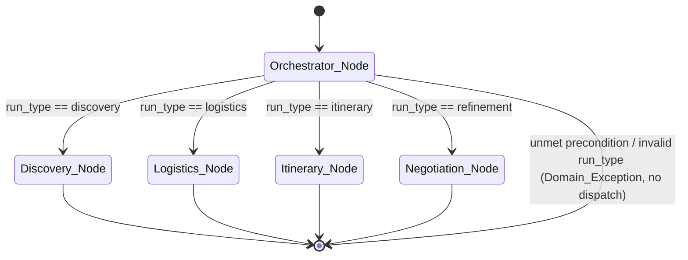
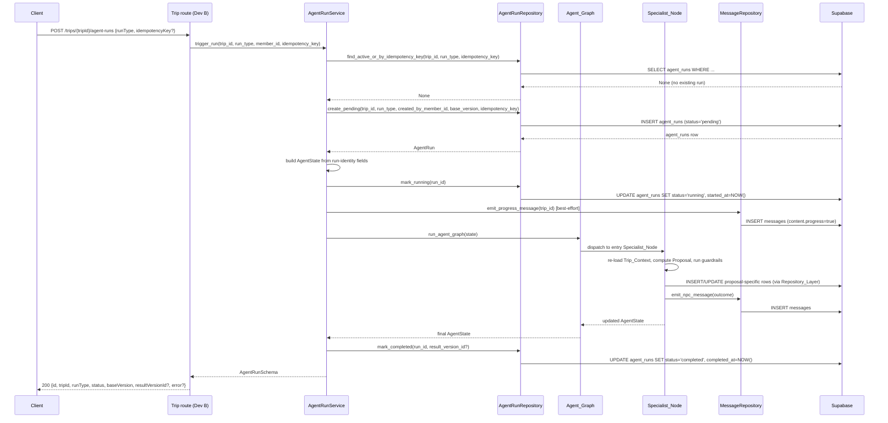
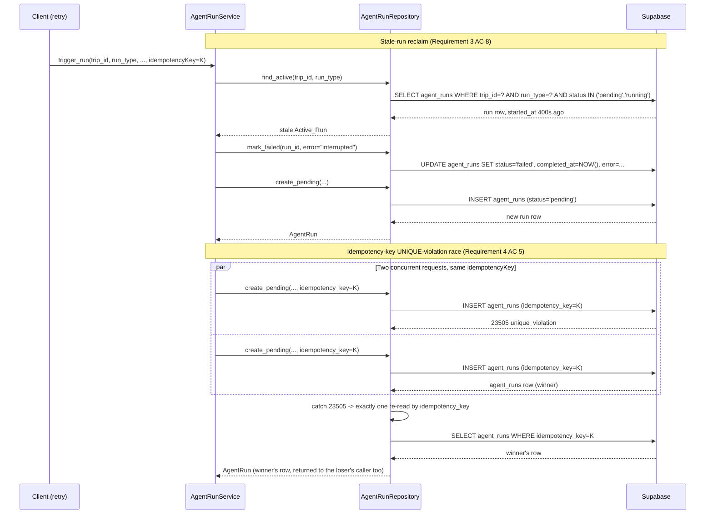
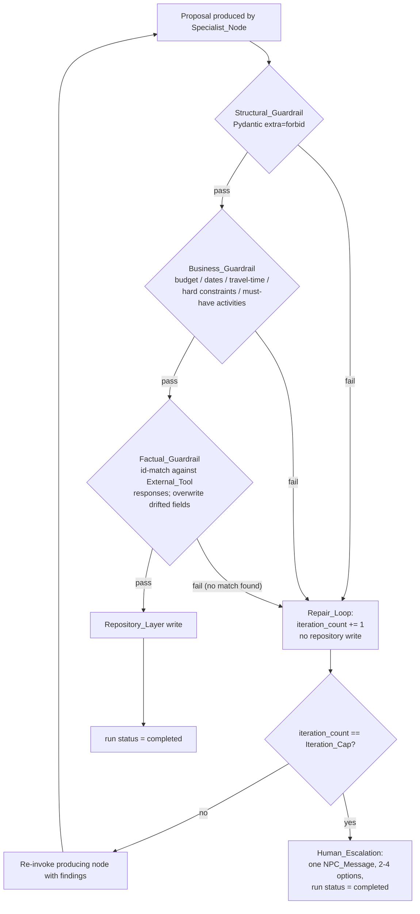

# Design Document: LangGraph AI Agent Layer (03-AI-agents)

## Overview

This document describes the technical design of the `Agent_Layer` — the LangGraph-based
NPC travel guide that reasons over party preferences, proposes destinations and flights,
drafts and refines the itinerary, and drives the six planning stages
(SETUP → DISCOVER → LOGISTICS → BUILD → REFINE ⭯ → WRAP). It implements the 22
requirements in `requirements.md`, built strictly against the live Supabase schema
(`supabase/migrations/20260925000000_initial_schema.sql`) and `api-contracts.md`.

The design follows the same three-layer architecture spec 02 established
(routes → services → repositories), adds one new layer beneath the service layer — the
`Agent_Layer` itself, invoked only by services — and never lets LangGraph become the
source of truth for trip data. Every persisted write goes through a `Repository_Layer`
method; the `Agent_Layer` reaches Supabase only that way, exactly like spec 02's
repositories.

**Scope boundary.** Spec 02 has defined but not yet implemented `RoomRepository`,
`MemberRepository`, and `ProfileRepository`, and only the health route exists in the
current codebase. This spec's design depends on new repositories
(`TripRepository`, `MessageRepository`, `VoteSessionRepository`, `VoteRepository`,
`SelectionRepository`, `ItineraryVersionRepository`, `FeedbackRepository`,
`AgentRunRepository`) that do not exist yet anywhere in the codebase or in spec 02's design.
This document specifies them as new additions this spec depends on (per requirements.md
Assumptions 1–2), following spec 02's `BaseRepository` pattern exactly. It also depends on
new `Service_Layer` trigger endpoints (preferences, votes, selections, feedback, agent
triggers) that are Dev B's prerequisite work, per requirements.md Assumption 1; this design
specifies the service-layer surface the agent layer needs from that work
(`AgentRunService.trigger_run(...)`) without re-specifying Dev B's full route/service set.

---

## Architecture

### Component Diagram

```mermaid
graph TD
    subgraph "HTTP Layer (Dev B, prerequisite)"
        R[POST /trips/agent-runs<br/>and other Dev B trigger routes]
    end

    subgraph "Service Layer"
        ARS[AgentRunService<br/>app/services/agent_run_service.py]
        VS[VoteService<br/>app/services/vote_service.py]
        TSS[TripStatusService<br/>app/services/trip_status_service.py]
    end

    subgraph "Agent Layer (this spec)"
        GRAPH[Agent_Graph<br/>app/agents/graph.py]
        ORC[Orchestrator_Node<br/>app/agents/nodes/orchestrator.py]
        DISC[Discovery_Node<br/>app/agents/nodes/discovery.py]
        LOG[Logistics_Node<br/>app/agents/nodes/logistics.py]
        ITIN[Itinerary_Node<br/>app/agents/nodes/itinerary.py]
        NEG[Negotiation_Node<br/>app/agents/nodes/negotiation.py]
        GUARD[Guardrail Pipeline<br/>app/agents/guardrails/]
        TOOLS[External Tools<br/>app/agents/tools/]
        STATE[Agent_State<br/>app/agents/state.py]
    end

    subgraph "Repository Layer"
        AR[AgentRunRepository]
        MR2[MessageRepository]
        VSR[VoteSessionRepository / VoteRepository]
        SR[SelectionRepository]
        TR[TripRepository]
        IVR[ItineraryVersionRepository]
        FR[FeedbackRepository]
        PR2[ProfileRepository<br/>(spec 02, reused read-only)]
        MEM[MemberRepository<br/>(spec 02, reused read-only)]
    end

    subgraph "Infrastructure"
        SC[AsyncClient factory<br/>app/db/supabase_client.py]
        DB[(Supabase / PostgreSQL)]
        LLM[LLM Provider]
        EXT[External APIs<br/>flights / places / weather]
    end

    R -->|Depends| ARS
    R -->|Depends| VS
    ARS -->|invokes| GRAPH
    ARS -->|Depends| AR
    VS -->|Depends| VSR
    VS -->|Depends| SR
    VS -->|Depends| TSS
    TSS -->|Depends| TR

    GRAPH --> ORC
    ORC --> DISC
    ORC --> LOG
    ORC --> ITIN
    ORC --> NEG
    DISC --> GUARD
    LOG --> GUARD
    ITIN --> GUARD
    NEG --> GUARD
    LOG --> TOOLS
    ITIN --> TOOLS
    NEG --> TOOLS
    TOOLS --> EXT
    DISC -. reads/writes .-> STATE
    LOG -. reads/writes .-> STATE
    ITIN -. reads/writes .-> STATE
    NEG -. reads/writes .-> STATE

    DISC -->|Depends, injected by service| MR2
    DISC --> VSR
    DISC --> PR2
    DISC --> MEM
    LOG --> SR
    ITIN --> SR
    ITIN --> IVR
    NEG --> IVR
    NEG --> FR
    DISC -. LLM calls .-> LLM
    LOG -. LLM calls .-> LLM
    ITIN -. LLM calls .-> LLM
    NEG -. LLM calls .-> LLM

    AR -->|Depends| SC
    MR2 -->|Depends| SC
    VSR -->|Depends| SC
    SR -->|Depends| SC
    TR -->|Depends| SC
    IVR -->|Depends| SC
    FR -->|Depends| SC
    SC --> DB
```

### Layer Responsibilities

| Layer | Location | Responsibility |
|---|---|---|
| Route (Dev B, prerequisite) | `app/api/routes/*.py` | Parse HTTP, delegate to `Service_Layer`, map domain exceptions to HTTP status |
| Service | `app/services/agent_run_service.py`, `app/services/vote_service.py`, `app/services/trip_status_service.py` | Create/reclaim `agent_runs` rows, resolve idempotency, invoke `Agent_Graph`, resolve votes, derive `trips.status`/`planning_stage` |
| Agent (this spec) | `app/agents/` | LangGraph graph, nodes, state, guardrails, external tool clients — the AI reasoning layer |
| Repository | `app/repositories/*.py` | All Supabase calls; wraps Supabase errors into `RepositoryError`, exactly per spec 02's pattern |
| Dependency wiring | `app/api/deps.py` | FastAPI dependency functions for the new repositories/services, added alongside spec 02's providers |
| Infra | `app/db/supabase_client.py` | Reused unchanged from spec 02 |

### Module Layout Under `backend/app/agents/`

```
app/agents/
├── __init__.py
├── graph.py              # compile_agent_graph() -> CompiledStateGraph; get_agent_graph() singleton accessor
├── state.py              # AgentState Pydantic model, accumulator bounds, mutation guards
├── nodes/
│   ├── __init__.py
│   ├── orchestrator.py   # orchestrator_node(state) -> AgentState
│   ├── discovery.py      # discovery_node(state) -> AgentState
│   ├── logistics.py      # logistics_node(state) -> AgentState
│   ├── itinerary.py      # itinerary_node(state) -> AgentState
│   └── negotiation.py    # negotiation_node(state) -> AgentState
├── guardrails/
│   ├── __init__.py
│   ├── structural.py     # Pydantic Proposal models + validate_structural(proposal_dict, kind)
│   ├── business.py       # deterministic check functions + run_business_guardrail(...)
│   └── factual.py        # provenance matching + run_factual_guardrail(...)
├── tools/
│   ├── __init__.py
│   ├── base.py           # ExternalTool base: timeout/retry/cache/cap bookkeeping
│   ├── flights.py        # FlightSearchTool, FlightOption Pydantic model
│   ├── places.py         # PlacesLookupTool, PlaceResult Pydantic model
│   └── weather.py        # WeatherLookupTool, WeatherDay Pydantic model
├── proposals.py          # DestinationRecommendationProposal, FlightRecommendationProposal,
│                          # ItineraryProposal, RefinementProposal (the 4 Proposal Pydantic models)
├── group_profile.py       # compute_group_profile(...) -> GroupProfile
├── messages.py            # emit_npc_message(...), emit_progress_message(...) helpers
└── errors.py              # Agent-layer-raised Domain_Exception subclasses (see Error Handling)
```

This mirrors spec 02's `app/api|core|db|repositories|schemas|services` convention: one
top-level package per architectural layer, with `agents/` as the new layer this spec adds.

---

### Agent Graph Topology (Requirement 1)



`Agent_Graph` is a `langgraph.graph.StateGraph[AgentState]` with exactly five nodes
(`orchestrator`, `discovery`, `logistics`, `itinerary`, `negotiation`), compiled once at
process import time in `app/agents/graph.py`:

```python
from functools import lru_cache
from langgraph.graph import StateGraph, END
from app.agents.state import AgentState
from app.agents.nodes.orchestrator import orchestrator_node
from app.agents.nodes.discovery import discovery_node
from app.agents.nodes.logistics import logistics_node
from app.agents.nodes.itinerary import itinerary_node
from app.agents.nodes.negotiation import negotiation_node

_ENTRY_NODE_BY_RUN_TYPE = {
    "discovery": "discovery",
    "logistics": "logistics",
    "itinerary": "itinerary",
    "refinement": "negotiation",
}


def _build_graph() -> StateGraph:
    graph = StateGraph(AgentState)
    graph.add_node("orchestrator", orchestrator_node)
    graph.add_node("discovery", discovery_node)
    graph.add_node("logistics", logistics_node)
    graph.add_node("itinerary", itinerary_node)
    graph.add_node("negotiation", negotiation_node)

    graph.set_entry_point("orchestrator")
    graph.add_conditional_edges(
        "orchestrator",
        lambda state: _ENTRY_NODE_BY_RUN_TYPE[state.run_type],
        _ENTRY_NODE_BY_RUN_TYPE,
    )
    for node_name in ("discovery", "logistics", "itinerary", "negotiation"):
        graph.add_edge(node_name, END)
    return graph


@lru_cache(maxsize=1)
def get_agent_graph():
    """Compiled once per process; reused for every Agent_Run (Requirement 1 AC 1)."""
    return _build_graph().compile()


async def run_agent_graph(state: AgentState) -> AgentState:
    """The single public entry point the Service_Layer calls (Requirement 1 AC 8)."""
    graph = get_agent_graph()
    result = await graph.ainvoke(state)
    return AgentState.model_validate(result)
```

`orchestrator_node` validates `state.run_type` is one of the four enum values (raising
`InvalidRunTypeError`, mapped to 422, before any dispatch — AC 5) and checks stage
preconditions via `Repository_Layer` reads only (never selecting a different entry node —
AC 4), raising `StagePreconditionNotMetError` (422) if unmet (AC 6). SETUP and WRAP do not
enter this graph at all: SETUP guidance messages and the WRAP summary are produced by
plain service-layer/helper code that emits `NPC_Message` rows directly and creates no
`agent_runs` row (AC 11–13), since neither corresponds to an `agent_run_type` value.

`app/api/routes/*.py` and `app/repositories/*.py` never import anything under
`app/agents/` (Requirement 1 AC 9, Requirement 20 AC 1–2) — only `app/services/*.py` does.

---

## Sequence Diagrams

### Trigger → Agent Run Lifecycle (happy path)



### Idempotency Key Race and Stale-Run Reclaim



---

## Components and Interfaces

### `app/agents/state.py` — `AgentState`

Requirement 2 partitions `AgentState` into exactly seven run-identity fields and exactly
eight execution-internal fields, with mutation restricted to two defined paths
(`base_version` via `Lost_Race` re-evaluation, `iteration_count` via the `Repair_Loop`
increment) and every other run-identity field frozen after construction.

```python
from typing import Any, Literal
from pydantic import BaseModel, ConfigDict, PrivateAttr, field_validator

RunType = Literal["discovery", "logistics", "itinerary", "refinement"]

_FROZEN_FIELDS = frozenset(
    {"run_id", "trip_id", "run_type", "created_by_member_id", "idempotency_key"}
)
_ACCUMULATOR_BOUNDS = {
    "guardrail_findings": 100,
    "external_tool_responses": None,  # bound is the run's Tool_Call_Cap, injected at construction
    "pending_npc_messages": 20,
}


class AgentState(BaseModel):
    """
    Run-identity group (7 fields, mirror agent_runs columns) and execution-internal
    group (8 fields, transient graph state) per Requirement 2 AC 1-3.
    """

    model_config = ConfigDict(validate_assignment=True, arbitrary_types_allowed=True)

    # --- run-identity group (Requirement 2 AC 2) ---
    run_id: str
    trip_id: str
    run_type: RunType
    base_version: int
    created_by_member_id: str | None
    idempotency_key: str | None
    iteration_count: int

    # --- execution-internal group (Requirement 2 AC 3) ---
    trip_context: dict[str, Any] | None = None
    group_profile: dict[str, Any] | None = None
    proposal: dict[str, Any] | None = None
    guardrail_findings: list[dict[str, Any]] = []
    external_tool_responses: list[dict[str, Any]] = []
    tool_call_count: int = 0
    pending_npc_messages: list[dict[str, Any]] = []
    repair_feedback: list[dict[str, Any]] = []

    # Internal, not a declared field: the Tool_Call_Cap this run was constructed with,
    # used to bound external_tool_responses (Requirement 2 AC 6).
    _tool_call_cap: int = PrivateAttr(default=10)

    @field_validator("run_id", "trip_id", "created_by_member_id")
    @classmethod
    def _validate_uuid(cls, v: str | None) -> str | None:
        import uuid

        if v is None:
            return v
        try:
            uuid.UUID(v)
        except ValueError as exc:
            raise ValueError(f"must be a valid UUID string: {v!r}") from exc
        return v

    @field_validator("idempotency_key")
    @classmethod
    def _validate_idempotency_key(cls, v: str | None) -> str | None:
        if v is not None and (not v.strip() or len(v) > 200):
            raise ValueError("idempotency_key must be 1-200 non-whitespace characters")
        return v

    @field_validator("base_version")
    @classmethod
    def _validate_base_version(cls, v: int) -> int:
        if v < 0:
            raise ValueError("base_version must be >= 0")
        return v

    def __setattr__(self, name: str, value: Any) -> None:
        """
        Reject mutation of the five frozen run-identity fields after construction
        (Requirement 2 AC 4-5). base_version and iteration_count are NOT in
        _FROZEN_FIELDS, so ordinary assignment is allowed for them, but callers are
        expected to go through with_base_version()/with_incremented_iteration() so the
        mutation is paired with the correct bookkeeping; direct assignment to those two
        fields is still permitted by this guard (Pydantic validators re-check bounds).
        """
        if name in _FROZEN_FIELDS and name in self.__dict__:
            raise RunIdentityMutationError(
                f"Attempted mutation of run-identity field '{name}'"
            )
        super().__setattr__(name, value)

    def with_base_version(self, new_base_version: int) -> "AgentState":
        """The sole sanctioned path for changing base_version (Lost_Race re-evaluation)."""
        return self.model_copy(update={"base_version": new_base_version})

    def with_incremented_iteration(self, cap: int) -> "AgentState":
        """The sole sanctioned path for changing iteration_count (Repair_Loop)."""
        if self.iteration_count >= cap:
            raise IterationCapExceededError(self.run_id, cap)
        return self.model_copy(update={"iteration_count": self.iteration_count + 1})

    def append_guardrail_findings(self, findings: list[dict[str, Any]]) -> "AgentState":
        combined = self.guardrail_findings + findings
        if len(combined) > _ACCUMULATOR_BOUNDS["guardrail_findings"]:
            raise StateBoundExceededError("guardrail_findings", len(combined))
        return self.model_copy(update={"guardrail_findings": combined})

    def append_tool_response(self, response: dict[str, Any]) -> "AgentState":
        combined = self.external_tool_responses + [response]
        if len(combined) > self._tool_call_cap:
            raise StateBoundExceededError("external_tool_responses", len(combined))
        return self.model_copy(update={"external_tool_responses": combined})

    def append_pending_message(self, message: dict[str, Any]) -> "AgentState":
        combined = self.pending_npc_messages + [message]
        if len(combined) > _ACCUMULATOR_BOUNDS["pending_npc_messages"]:
            raise StateBoundExceededError("pending_npc_messages", len(combined))
        return self.model_copy(update={"pending_npc_messages": combined})
```

**Mutation enforcement mechanism.** `model_copy(update=...)` is used for every state
transition instead of in-place mutation, because LangGraph nodes are expected to return a
new state object rather than mutate the one they received (this is also how LangGraph's
own reducer model works). The `__setattr__` override is a defense-in-depth guard against
accidental in-place writes to the five frozen fields (`run_id`, `trip_id`, `run_type`,
`created_by_member_id`, `idempotency_key`); `base_version` and `iteration_count` are
intentionally excluded from `_FROZEN_FIELDS` and are mutated only via
`with_base_version()`/`with_incremented_iteration()`, which apply the AC 11
(`iteration_count <= Iteration_Cap`) bound before returning. This satisfies Requirement 2
AC 4–5: a node that attempts `state.run_id = "..."` raises `RunIdentityMutationError`
before any `Repository_Layer` write for that node execution, and `AgentState` itself is
left unchanged because Pydantic validation runs before `__setattr__`'s exception aborts
the assignment.

Every accumulator append goes through a dedicated `append_*` method that enforces the
bound from Requirement 2 AC 6–7 (100 findings / `Tool_Call_Cap` tool responses / 20 pending
messages) and raises `StateBoundExceededError` — mapped to HTTP 409 per Requirement 20 AC
9 — rather than silently truncating.

---

### `app/repositories/` — New Repositories

None of these exist yet. Each follows spec 02's `BaseRepository(client)` constructor and
`_handle_error(exc, operation, table)` pattern exactly.

#### `app/repositories/trip_repository.py`

```python
class TripRepository(BaseRepository):
    async def get_by_id(self, trip_id: str) -> dict | None: ...
    async def get_by_room_id(self, room_id: str) -> dict | None: ...
    async def get_room_id_for_trip(self, trip_id: str) -> str | None:
        """Resolves room_id from trip_id for NPC message emission (Requirement 15 AC 1)."""
        ...
    async def update_status(self, trip_id: str, status: str, planning_stage: str) -> dict:
        """
        Writes trips.status and party_rooms.planning_stage in a single Supabase RPC
        transaction (create_room_with_owner-style) so no read observes one updated
        without the other (Requirement 18 AC 10). Raises RepositoryError on failure.
        """
        ...
```

#### `app/repositories/message_repository.py`

```python
class MessageRepository(BaseRepository):
    async def insert_turn(self, room_id: str, messages: list[dict]) -> list[dict]:
        """
        Inserts 1-5 messages for one agent turn via the insert_message_turn RPC
        (see below) so the turn commits atomically (Requirement 15 AC 11).
        Each message dict carries sender_type, sender_member_id, kind, content.
        Raises RepositoryError; never partially commits.
        """
        ...
    async def get_latest_progress_message(self, run_id: str) -> dict | None: ...
```

`insert_turn` calls a new PostgreSQL function `insert_message_turn(p_room_id, p_messages
jsonb)` (see Data Models) that loops over the input array inside one transaction, assigning
strictly increasing `created_at` timestamps (1ms apart) and rolling back entirely if any
row's `content` exceeds 16,384 bytes or fails the `messages` CHECK constraint.

#### `app/repositories/vote_session_repository.py` and `vote_repository.py`

```python
class VoteSessionRepository(BaseRepository):
    async def create(
        self, room_id: str, message_id: str, question: str, options: list[dict]
    ) -> dict: ...
    async def get_open_by_room_and_category(self, room_id: str, category: str) -> dict | None:
        """category is 'destination' or 'flight', resolved via the linked message's
        content.category (Requirement 7 AC 8, Requirement 8 AC 9)."""
        ...
    async def close(self, vote_session_id: str) -> dict: ...
    async def get_by_id(self, vote_session_id: str) -> dict | None: ...


class VoteRepository(BaseRepository):
    async def upsert(self, vote_session_id: str, member_id: str, option_id: str) -> dict:
        """Relies on UNIQUE(vote_session_id, member_id); re-voting replaces the row."""
        ...
    async def count_by_option(self, vote_session_id: str) -> dict[str, int]: ...
    async def count_distinct_voters(self, vote_session_id: str) -> int: ...
```

#### `app/repositories/selection_repository.py`

```python
class SelectionRepository(BaseRepository):
    async def get_by_room_and_kind(self, room_id: str, kind: str) -> dict | None: ...
    async def upsert(
        self, room_id: str, kind: str, data: dict, vote_session_id: str | None
    ) -> dict:
        """UPDATE if a (room_id, kind) row exists, else INSERT (Requirement 17 AC 3)."""
        ...
```

#### `app/repositories/itinerary_version_repository.py`

```python
class ItineraryVersionRepository(BaseRepository):
    async def get_latest(self, trip_id: str) -> dict | None: ...
    async def insert_version(
        self,
        trip_id: str,
        version: int,
        source: str,
        itinerary: dict,
        change_summary: str | None,
    ) -> dict:
        """
        Raw INSERT. Lets the UNIQUE(trip_id, version) violation surface as a
        RepositoryError-wrapped exception carrying the Postgres 23505 marker so the
        Itinerary_Node/Negotiation_Node can distinguish a Lost_Race from any other
        failure (Requirement 5 AC 3, AC 13). Never issues UPDATE on the itinerary column.
        """
        ...
    async def supersede_lower_versions(self, trip_id: str, below_version: int) -> None:
        """Sets status='superseded' on proposed rows with version < below_version,
        leaving approved/rejected rows untouched (Requirement 5 AC 9)."""
        ...
    async def mark_approved(self, itinerary_version_id: str) -> dict:
        """Enforces uq_itinerary_versions_one_approved; raises DuplicateApprovalError
        (409) if the partial unique index would be violated (Requirement 5 AC 10)."""
        ...
```

#### `app/repositories/feedback_repository.py`

```python
class FeedbackRepository(BaseRepository):
    async def list_open_by_trip(self, trip_id: str, limit: int = 50) -> list[dict]: ...
    async def mark_addressed(self, feedback_ids: list[str]) -> None: ...
    async def create(
        self, trip_id: str, itinerary_version_id: str, member_id: str, target: dict, comment: str
    ) -> dict: ...
```

#### `app/repositories/agent_run_repository.py`

```python
class AgentRunRepository(BaseRepository):
    async def get_by_idempotency_key(self, idempotency_key: str) -> dict | None: ...
    async def get_active(self, trip_id: str, run_type: str) -> dict | None:
        """status IN ('pending','running')."""
        ...
    async def create_pending(
        self,
        trip_id: str,
        run_type: str,
        created_by_member_id: str | None,
        base_version: int,
        idempotency_key: str | None,
    ) -> dict:
        """
        Catches Postgres 23505 on idempotency_key: performs exactly one re-read by that
        key and returns it (Requirement 4 AC 5), or raises IdempotencyKeyConflictError
        if the re-read finds nothing.
        """
        ...
    async def mark_running(self, run_id: str) -> dict:
        """Only if current status == 'pending'; no-ops (does not overwrite) if
        started_at is already non-NULL."""
        ...
    async def mark_completed(self, run_id: str, result_version_id: str | None) -> dict: ...
    async def mark_failed(self, run_id: str, error: str) -> dict: ...
    async def get_by_id(self, run_id: str) -> dict | None: ...
```

`AgentRunRepository` is the sole enforcer of the status-transition state machine
(`pending → running`, `running → completed`, `running → failed`, `pending → failed`); any
other transition raises `RunStatusTransitionError` (409) and leaves the row untouched
(Requirement 3 AC 7, AC 11).

### DI Wiring Additions (`app/api/deps.py`)

Added alongside spec 02's existing providers, following the identical pattern:

```python
def get_trip_repo(client: AsyncClient = Depends(get_supabase_client)) -> TripRepository:
    return TripRepository(client)

def get_message_repo(client: AsyncClient = Depends(get_supabase_client)) -> MessageRepository:
    return MessageRepository(client)

def get_vote_session_repo(client: AsyncClient = Depends(get_supabase_client)) -> VoteSessionRepository:
    return VoteSessionRepository(client)

def get_vote_repo(client: AsyncClient = Depends(get_supabase_client)) -> VoteRepository:
    return VoteRepository(client)

def get_selection_repo(client: AsyncClient = Depends(get_supabase_client)) -> SelectionRepository:
    return SelectionRepository(client)

def get_itinerary_version_repo(client: AsyncClient = Depends(get_supabase_client)) -> ItineraryVersionRepository:
    return ItineraryVersionRepository(client)

def get_feedback_repo(client: AsyncClient = Depends(get_supabase_client)) -> FeedbackRepository:
    return FeedbackRepository(client)

def get_agent_run_repo(client: AsyncClient = Depends(get_supabase_client)) -> AgentRunRepository:
    return AgentRunRepository(client)


def get_agent_run_service(
    agent_run_repo: AgentRunRepository = Depends(get_agent_run_repo),
    trip_repo: TripRepository = Depends(get_trip_repo),
    message_repo: MessageRepository = Depends(get_message_repo),
    member_repo: MemberRepository = Depends(get_member_repo),
    profile_repo: ProfileRepository = Depends(get_profile_repo),
    itinerary_version_repo: ItineraryVersionRepository = Depends(get_itinerary_version_repo),
    selection_repo: SelectionRepository = Depends(get_selection_repo),
    feedback_repo: FeedbackRepository = Depends(get_feedback_repo),
) -> "AgentRunService":
    return AgentRunService(
        agent_run_repo=agent_run_repo,
        trip_repo=trip_repo,
        message_repo=message_repo,
        member_repo=member_repo,
        profile_repo=profile_repo,
        itinerary_version_repo=itinerary_version_repo,
        selection_repo=selection_repo,
        feedback_repo=feedback_repo,
    )


def get_vote_service(
    vote_session_repo: VoteSessionRepository = Depends(get_vote_session_repo),
    vote_repo: VoteRepository = Depends(get_vote_repo),
    selection_repo: SelectionRepository = Depends(get_selection_repo),
    message_repo: MessageRepository = Depends(get_message_repo),
    trip_status_service: "TripStatusService" = Depends(lambda: None),  # wired via get_trip_status_service
) -> "VoteService":
    return VoteService(vote_session_repo, vote_repo, selection_repo, message_repo, trip_status_service)
```

`Agent_Layer` node code never calls these `get_*` functions directly; every
`Repository_Layer` instance a node needs is threaded through `AgentRunService.trigger_run`
into the graph invocation as part of a `RepositoryBundle` passed alongside `AgentState`
(nodes are plain async functions of `(state, repos) -> state`; LangGraph supports this via
`graph.ainvoke(state, config={"configurable": {"repos": bundle}})`), so
`app/agents/` never constructs a repository or a Supabase client itself (Requirement 20
AC 1).

```python
# app/agents/state.py (continued)
from dataclasses import dataclass

@dataclass(frozen=True)
class RepositoryBundle:
    """Passed via LangGraph's `configurable` channel; never constructed inside app/agents/."""
    trip_repo: "TripRepository"
    member_repo: "MemberRepository"
    profile_repo: "ProfileRepository"
    message_repo: "MessageRepository"
    vote_session_repo: "VoteSessionRepository"
    selection_repo: "SelectionRepository"
    itinerary_version_repo: "ItineraryVersionRepository"
    feedback_repo: "FeedbackRepository"
    agent_run_repo: "AgentRunRepository"
    flight_tool: "FlightSearchTool"
    places_tool: "PlacesLookupTool"
    weather_tool: "WeatherLookupTool"
    llm: "LLMClient"
```

---

## Algorithmic Pseudocode

### `ItineraryNode` / `NegotiationNode` — Version Insert with Optimistic Lock

```
function persist_itinerary_version(state, repos, itinerary_dict, source, change_summary):
    # Requirement 5 AC 1, AC 3-6, AC 11-13
    lost_race_count = 0
    while lost_race_count <= 2:
        candidate_version = state.base_version + 1
        try:
            row = await repos.itinerary_version_repo.insert_version(
                trip_id=state.trip_id,
                version=candidate_version,
                source="build" if candidate_version == 1 else "refine",
                itinerary=itinerary_dict,
                change_summary=change_summary,
            )
            # Success: supersede older proposed rows, never touch approved/rejected.
            await repos.itinerary_version_repo.supersede_lower_versions(
                state.trip_id, below_version=row["version"]
            )
            return row, state

        except UniqueVersionViolation:
            lost_race_count += 1
            latest = await repos.itinerary_version_repo.get_latest(state.trip_id)
            state = state.with_base_version(latest["version"])

            still_applicable = evaluate_applicability(
                proposal_affected_scope=state.proposal["affected_scope"],
                base_snapshot=state.trip_context["itinerary_at_generation"],
                refetched=latest,
                addressed_feedback=await repos.feedback_repo.list_open_by_trip(state.trip_id),
                current_selections=await load_current_selections(repos, state),
            )
            if not still_applicable:
                # AC 6: complete with no write, emit exactly one NPC_Message.
                return None, state

            # still applicable: loop and retry insert at the new base_version + 1
            continue

        except RepositoryError as exc:
            # AC 13: not a UNIQUE(trip_id, version) violation -> fail the run, no retry.
            raise ItineraryPersistenceError(state.run_id) from exc

    # AC 12: third Lost_Race within the same run.
    raise RepeatedVersionContentionError(state.run_id)
```

`UniqueVersionViolation` is a narrow exception type `ItineraryVersionRepository` raises
specifically when the wrapped Postgres error code is `23505` on the `(trip_id, version)`
constraint; any other Postgres error is re-raised as the generic `RepositoryError` so the
`except RepositoryError` branch above never misclassifies a different failure as a
`Lost_Race` (Requirement 5 AC 13).

### `TiebreakFlow.resolve` — Deterministic Vote Resolution

```
function resolve_vote_session(vote_session, votes, repos):
    # Requirement 17 AC 6-11
    counts = tally(votes)  # {option_id: count}, only counting members still in room_members
    highest = max(counts.values())
    winners = [option_id for option_id, c in counts.items() if c == highest]

    if len(winners) == 1:
        winning_option_id = winners[0]
        tie_note = None
    else:
        # Option_Index_Rule: lowest zero-based index in vote_sessions.options wins.
        ordered_ids = [opt["id"] for opt in vote_session["options"]]
        winning_option_id = min(winners, key=lambda oid: ordered_ids.index(oid))
        tie_note = {"tied_ids": winners, "tied_count": highest, "winner": winning_option_id}

    winning_option = next(o for o in vote_session["options"] if o["id"] == winning_option_id)
    category = resolve_category_from_linked_message(vote_session, repos)  # 'destination' | 'flight'

    # Single transaction: write selections + close vote_sessions (AC 1).
    await repos.selection_repo.upsert(
        room_id=vote_session["room_id"], kind=category,
        data=winning_option, vote_session_id=vote_session["id"],
    )
    await repos.vote_session_repo.close(vote_session["id"])

    if tie_note:
        await emit_npc_message(repos, kind="summary", content={**tie_note, "category": category})

    await advance_trip_status_for_selection(repos, vote_session["room_id"], category)
    return winning_option
```

---

## Data Models

### Proposal Pydantic Models (`app/agents/proposals.py`) — Structural Guardrail (Req 11)

All four models use `model_config = ConfigDict(extra="forbid")`, applied recursively to
every nested model, so an unknown field fails validation (AC 1). Every field
`api-contracts.md` does not mark optional/nullable is required (AC 2).

```python
from pydantic import BaseModel, ConfigDict, Field

class _StrictModel(BaseModel):
    model_config = ConfigDict(extra="forbid")


class RecommendationItem(_StrictModel):
    id: str
    title: str
    description: str
    image_url: str | None = None
    sprite_key: str | None = None
    meta: dict[str, str | int | float | bool] | None = None


class DestinationRecommendationProposal(_StrictModel):
    title: str
    category: Literal["destination"] = "destination"
    items: list[RecommendationItem] = Field(min_length=3, max_length=5)
    prompt: str | None = None


class FlightRecommendationProposal(_StrictModel):
    title: str
    category: Literal["flight"] = "flight"
    items: list[RecommendationItem] = Field(min_length=3, max_length=5)
    prompt: str | None = None


class ItineraryItemModel(_StrictModel):
    id: str
    time: str | None = None
    title: str
    description: str | None = None
    location: str | None = None
    tags: list[str] | None = None


class ItineraryDayModel(_StrictModel):
    day: int = Field(ge=1)
    date: str | None = None
    items: list[ItineraryItemModel] = Field(min_length=1, max_length=10)


class MapPointModel(_StrictModel):
    label: str
    lat: float
    lng: float


class ItineraryProposal(_StrictModel):
    trip_id: str
    room_id: str
    title: str
    summary: str
    destination: dict[str, str | None]
    dates: dict[str, str] | None = None
    days: list[ItineraryDayModel] = Field(min_length=1)
    map: list[MapPointModel] | None = None
    affected_scope: dict[str, list] = Field(default_factory=lambda: {"days": [], "item_ids": []})


class RefinementProposal(_StrictModel):
    itinerary: ItineraryProposal
    change_summary: str = Field(min_length=1, max_length=500)
    conflicts_resolved: list[dict[str, str]] = Field(default_factory=list)
```

`affected_scope` is carried on `ItineraryProposal`/`RefinementProposal` purely as
agent-internal bookkeeping consumed by `persist_itinerary_version` above; it is not part
of the persisted `itinerary` jsonb column (the repository strips it before insert) and is
therefore not a contract addition — it never reaches `api-contracts.md` or the frontend.

#### Enum-Column Validators (Req 11 AC 8)

```python
_ENUM_COLUMNS: dict[str, frozenset[str]] = {
    "message_kind": frozenset({"text", "recommendation", "vote", "summary"}),
    "itinerary_source": frozenset({"build", "refine"}),
    "itinerary_status": frozenset({"proposed", "approved", "rejected", "superseded"}),
    "vote_session_status": frozenset({"open", "closed"}),
    "selection_kind": frozenset({"destination", "flight"}),
    "feedback_status": frozenset({"open", "addressed"}),
    "trip_status": frozenset({
        "trip_created", "group_formed", "preferences_collected", "destination_selected",
        "flight_selected", "itinerary_generated", "feedback_collected",
        "refinement_completed", "trip_approved", "trip_exported",
    }),
    "agent_run_type": frozenset({"discovery", "logistics", "itinerary", "refinement"}),
    "agent_run_status": frozenset({"pending", "running", "completed", "failed"}),
}


def validate_enum_column(column: str, value: str) -> None:
    if value not in _ENUM_COLUMNS[column]:
        raise StructuralGuardrailError(column, value, _ENUM_COLUMNS[column])
```

### External Tool Response Models (`app/agents/tools/`) — Requirement 19

```python
class FlightOption(_StrictModel):
    id: str
    carrier: str
    flight_number: str
    origin: str
    destination: str
    depart_at: str
    arrive_at: str
    price: float = Field(ge=0)
    duration_minutes: int = Field(ge=0)
    stops: int = Field(ge=0)


class FlightSearchResponse(_StrictModel):
    options: list[FlightOption]


class PlaceResult(_StrictModel):
    id: str
    name: str
    lat: float
    lng: float
    opening_hours: str | None = None


class PlacesLookupResponse(_StrictModel):
    places: list[PlaceResult]


class WeatherDay(_StrictModel):
    date: str
    temperature_c: float
    precipitation: str


class WeatherLookupResponse(_StrictModel):
    days: list[WeatherDay]
```

```python
# app/agents/tools/base.py
import asyncio
from app.core.config import get_settings

class ExternalTool:
    name: str

    def __init__(self) -> None:
        self._settings = get_settings()
        self._cache: dict[tuple, BaseModel] = {}

    async def invoke(self, state: AgentState, **params) -> tuple[BaseModel, AgentState]:
        cache_key = (self.name, tuple(sorted(params.items())))
        if cache_key in self._cache:
            return self._cache[cache_key], state  # AC 9: cached reuse, no cap consumption

        if len(state.external_tool_responses) >= state.tool_call_cap:
            raise ToolCallCapExceededError(self.name)

        for attempt in range(2):  # AC 8: at most 1 retry
            try:
                raw = await asyncio.wait_for(
                    self._call(**params), timeout=self._settings.external_tool_timeout_seconds
                )
                validated = self._response_model.model_validate(raw)  # AC 1, AC 6
                self._cache[cache_key] = validated
                state = state.append_tool_response(validated.model_dump())
                return validated, state
            except (asyncio.TimeoutError, TransportError):
                if attempt == 1:
                    raise ExternalToolUnavailableError(self.name)
            except ValidationError:
                raise ExternalToolUnavailableError(self.name)  # AC 6: no retry on validation failure

    async def _call(self, **params) -> dict:
        raise NotImplementedError
```

`external_tool_timeout_seconds` (default 10, range 1-60) and `iteration_cap` (default 3,
range 1-10) and `tool_call_cap` (default 10, range 1-50) are added to `Settings` in
`app/core/config.py`, read through `Settings` rather than embedded literals
(Requirement 12 AC 10, Requirement 19 AC 4).

### `agent_runs` API Shape (unchanged from `api-contracts.md`)

```python
class AgentRunSchema(_Base):
    id: str
    trip_id: str
    run_type: Literal["discovery", "logistics", "itinerary", "refinement"]
    status: Literal["pending", "running", "completed", "failed"]
    base_version: int
    result_version_id: str | None = None
    error: str | None = None
```

Exposes exactly the seven fields in `api-contracts.md`'s "AI Runs" shape
(Requirement 4 AC 6); `idempotency_key`, `created_by_member_id`, `iteration_count`,
`started_at`, `completed_at` are never serialized to the caller.

### `messages.content` Shapes (DB/contract-correct, not narrowed to frontend drift)

```python
class TextMessageContent(_Base):
    text: str = Field(max_length=280)
    options: list[dict[str, str]] | None = Field(default=None, min_length=2, max_length=6)
    stage: Literal["setup", "discover", "logistics", "build", "refine", "wrap"]
    progress: bool | None = None  # Backend Change Request Entry 2; see Error Handling note


class RecommendationMessageContent(_Base):
    title: str
    category: Literal["destination", "flight"] | None = None
    items: list[RecommendationItem]
    prompt: str | None = None


class VoteMessageContent(_Base):
    vote_session_id: str
    room_id: str
    question: str
    options: list[dict[str, str | int]]
    status: Literal["open", "closed"]


class SummaryMessageContent(_Base):
    text: str
    itinerary_version_id: str | None = None
    change_summary: str | None = None
```

Per requirements.md's Frontend Reconciliation section, `ItineraryVersion`/`ItineraryItem`
persisted and emitted by this design always carry `id` and `status`
(`itinerary_status` enum) regardless of the frontend type's current gap — the agent
layer's Pydantic models above are the authority, not the drifted frontend TypeScript
types (Requirement 9 AC 16, Requirement 10 AC 16).

### New SQL Additions This Spec Requires (no schema changes to existing tables)

Two new PostgreSQL functions are needed to make Requirement 15 AC 11 (atomic multi-message
turns) and Requirement 18 AC 10 (atomic `trips.status` + `party_rooms.planning_stage`
write) implementable without a schema change to any table, column, or enum:

```sql
-- supabase/migrations/20260925000003_agent_support_functions.sql (proposed by this design)
CREATE OR REPLACE FUNCTION insert_message_turn(p_room_id UUID, p_messages JSONB)
RETURNS SETOF messages
LANGUAGE plpgsql AS $$
DECLARE
  m JSONB;
  i INT := 0;
BEGIN
  FOR m IN SELECT * FROM jsonb_array_elements(p_messages) LOOP
    INSERT INTO messages (room_id, sender_type, sender_member_id, kind, content, created_at)
    VALUES (
      p_room_id,
      (m->>'sender_type')::sender_type,
      NULLIF(m->>'sender_member_id', '')::UUID,
      (m->>'kind')::message_kind,
      m->'content',
      NOW() + (i * INTERVAL '1 millisecond')
    );
    i := i + 1;
  END LOOP;
  RETURN QUERY SELECT * FROM messages WHERE room_id = p_room_id ORDER BY created_at DESC LIMIT jsonb_array_length(p_messages);
END;
$$;

CREATE OR REPLACE FUNCTION set_trip_status_and_stage(
  p_trip_id UUID, p_status trip_status, p_planning_stage planning_stage
) RETURNS trips
LANGUAGE plpgsql AS $$
DECLARE
  v_trip trips;
  v_room_id UUID;
BEGIN
  UPDATE trips SET status = p_status WHERE id = p_trip_id RETURNING *, room_id INTO v_trip, v_room_id;
  UPDATE party_rooms SET planning_stage = p_planning_stage WHERE id = v_room_id;
  RETURN v_trip;
END;
$$;
```

This is additive (new functions only, no `ALTER TABLE`), consistent with spec 02's own use
of an RPC (`create_room_with_owner`) for atomicity, and does not require a new Backend
Change Request entry since it introduces no new table, column, enum value, index,
constraint, or publication change — the bar requirements.md sets for that section.

---

## Node Designs

### Discovery_Node (Requirement 7) — `app/agents/nodes/discovery.py`

```python
async def discovery_node(state: AgentState, repos: RepositoryBundle) -> AgentState:
    members = await repos.member_repo.list_members_by_room(room_id)  # re-fetched fresh (Req 6)
    prefs = [await repos.profile_repo.get_preferences_by_member_id(m["id"]) for m in members]
    if not any(prefs):
        raise PreferencesNotCollectedError(state.trip_id)

    profile = compute_group_profile(members, prefs)  # app/agents/group_profile.py
    state = state.model_copy(update={"group_profile": profile.model_dump()})

    if not profile.availability_overlap:
        return await escalate(state, repos, reason="no_shared_dates")

    candidates = seed_from_travel_preferences(prefs) + await generate_llm_candidates(profile)
    filtered = [c for c in candidates if satisfies_hard_constraints(c, profile.hard_constraints)
                and within_budget(c, profile.budget_ceiling)]
    if not filtered:
        return await escalate(state, repos, reason="constraints_eliminated_all_candidates")

    proposal = DestinationRecommendationProposal(items=filtered[:5], ...)
    state, proposal = await run_guardrail_pipeline(state, repos, proposal, kind="destination")
    await close_open_vote_session_if_same_category(repos, room_id, "destination")
    message = await emit_npc_message(repos, kind="recommendation", content=proposal)
    await repos.vote_session_repo.create(room_id, message["id"], question=..., options=[...])
    return state
```

`compute_group_profile` implements Requirement 7 AC 1–3 exactly: availability overlap is
the date-range intersection across members with at least one range; interests/activities
are unioned; hard constraints are unioned; `budget_ceiling` is the minimum non-NULL
`budget`, treated as unconstrained when every row is NULL. The `Group_Profile` is held only
on `AgentState.group_profile` and never written to Supabase (AC 4).

### Logistics_Node (Requirement 8) — `app/agents/nodes/logistics.py`

Loads the `kind='destination'` selection (raising `DestinationNotSelectedError` if absent,
AC 2) and the party's preferences, derives `Availability_Overlap`/`Budget_Ceiling` the same
way as Discovery, escalates if the overlap is empty or no origin resolves (AC 10–11) without
calling `FlightSearchTool`, otherwise calls it, excludes options outside the overlap or over
budget (AC 6), escalates if that empties the result set (AC 7), and otherwise ranks by
`(price asc, duration asc, stops asc)` (AC 8) before emitting the recommendation and closing
any prior open flight vote session (AC 9). The interim departure-origin behavior is the
documented deviation in requirements.md's Backend Change Requests Entry 1: the node reads
the origin from a conventioned `hard_constraints` entry
(`{"type": "departure_origin", "value": "<IATA or city>"}`) and treats its absence as an
escalation, never a guess.

### Itinerary_Node (Requirement 9) — `app/agents/nodes/itinerary.py`

Loads both selections and preferences (AC 1), derives day count from the flight dates or
the availability overlap (AC 3–4), fails with `InvalidTripDurationError` outside 1–30 days
(AC 5), generates 1–10 items per day ordered by time-then-generation-order (AC 6), assigns
globally unique item ids (AC 9), and calls `persist_itinerary_version(..., source="build")`
from the Algorithmic Pseudocode section, which is only reachable when no
`itinerary_versions` row exists yet for the trip — the service layer routes to
`Negotiation_Node` instead when one already exists (AC 8). On success it emits a
`kind='summary'` message and sets `trips.status='itinerary_generated'` (AC 14–15).

### Negotiation_Node (Requirement 10) — `app/agents/nodes/negotiation.py`

```python
async def negotiation_node(state: AgentState, repos: RepositoryBundle) -> AgentState:
    base = await repos.itinerary_version_repo.get_latest(state.trip_id)
    if base is None:
        raise NoItineraryToRefineError(state.trip_id)

    open_feedback = await repos.feedback_repo.list_open_by_trip(state.trip_id, limit=50)
    if not open_feedback:
        await emit_npc_message(repos, kind="text", content={"text": "Nothing outstanding to negotiate."})
        return state  # AC 13: completed, no version insert, status untouched

    resolvable, unresolvable = partition_by_target_resolution(open_feedback, base["itinerary"])
    affected_scope = compute_affected_scope(resolvable, base["itinerary"])  # AC 2
    conflicts = detect_conflicts(resolvable)  # deterministic, non-LLM (AC 8-9)

    new_itinerary = regenerate_affected_only(
        base["itinerary"], affected_scope, resolvable, conflicts,
    )
    assert_unaffected_scope_identical(base["itinerary"], new_itinerary, affected_scope)  # AC 3

    row, state = await persist_itinerary_version(
        state, repos, new_itinerary, source="refine",
        change_summary=build_change_summary(affected_scope, resolvable),
    )
    if row is not None:
        await repos.feedback_repo.mark_addressed([f["id"] for f in resolvable])
        if conflicts:
            await emit_npc_message(repos, kind="summary", content={"conflicts": conflicts})
        await repos.trip_repo.update_status(state.trip_id, "refinement_completed", "refine")
    for f in unresolvable:
        # AC 14-15: target not found (structured or legacy flat-string), left open.
        await emit_npc_message(repos, kind="text", content={"text": f"Could not locate: {f['target']}"})
    return state
```

`compute_affected_scope` implements Requirement 10 AC 2: the union of every feedback
target's day/item, every same-day item whose time range overlaps a changed item, and the
immediately-adjacent items in that day's ordered list. `partition_by_target_resolution`
implements AC 15's legacy flat-string interim handling — attempting an exact match against
item ids or day numbers before falling back to the AC 14 not-found path.

### External Tools — Cap/Timeout/Retry/Cache (Requirement 19)

`ExternalTool.invoke` (shown in Data Models) implements all four mechanisms in one place:
a per-tool response cache keyed by `(tool_name, sorted(params))` so identical calls within
a run never increment `tool_call_count` (AC 9); a check against `Tool_Call_Cap` before
issuing a new call, escalating rather than substituting model data when exhausted (AC 3);
`asyncio.wait_for` bounding every call to `Settings.external_tool_timeout_seconds` (AC 7);
and exactly one retry on timeout/transport error only, never on validation failure (AC 6,
AC 8).

---

## Guardrail Pipeline (Requirements 11–14)



```python
async def run_guardrail_pipeline(
    state: AgentState, repos: RepositoryBundle, proposal_dict: dict, kind: str
) -> tuple[AgentState, BaseModel | None]:
    while True:
        structural_findings = validate_structural(proposal_dict, kind)  # Req 11
        if structural_findings:
            state = state.append_guardrail_findings(structural_findings)
            state, proposal_dict = await _repair_or_escalate(state, repos, structural_findings)
            if proposal_dict is None:
                return state, None  # escalated
            continue

        proposal = _MODEL_BY_KIND[kind].model_validate(proposal_dict)
        business_findings = run_business_guardrail(proposal, state.group_profile, state.trip_context)  # Req 12
        if business_findings:
            state = state.append_guardrail_findings(business_findings)
            state, proposal_dict = await _repair_or_escalate(state, repos, business_findings)
            if proposal_dict is None:
                return state, None
            continue

        proposal, factual_findings = run_factual_guardrail(proposal, state.external_tool_responses)  # Req 13
        if factual_findings:
            state = state.append_guardrail_findings(factual_findings)
            state, proposal_dict = await _repair_or_escalate(state, repos, factual_findings)
            if proposal_dict is None:
                return state, None
            continue

        return state, proposal  # all three layers passed; caller performs the write


async def _repair_or_escalate(state, repos, findings):
    cap = state.iteration_cap  # read from Settings at construction
    if state.iteration_count < cap:
        state = state.with_incremented_iteration(cap)
        new_proposal_dict = await regenerate_with_feedback(state, findings)
        return state, new_proposal_dict
    await perform_human_escalation(state, repos, findings)  # Req 14 AC 2-5
    return state, None
```

`run_business_guardrail` and `run_factual_guardrail` are plain, deterministic functions
with no LLM or tool call inside them (Requirement 12 AC 1, Requirement 13 implicit) —
`run_business_guardrail` evaluates the five checks (budget, dates, travel-time, hard
constraints, must-have activities) in that fixed order and returns every failing check's
finding in one pass (Req 12 AC 12–13); `run_factual_guardrail` matches by exact
case-sensitive id equality only (Req 13 AC 3) and overwrites drifted factual fields with
the tool value only after confirming every item in the proposal has a match (Req 13 AC 6).
`perform_human_escalation` sets `agent_runs.status='completed'` (not `failed`) per
Requirement 14 AC 5 and Assumption 15, because the escalation is a successfully delivered
NPC request rather than a technical fault.

---

## Vote Resolution and Status/Stage Derivation (Requirements 17–18)

### Status → Planning Stage Mapping (Requirement 18 AC 10)

| `trips.status` | `party_rooms.planning_stage` |
|---|---|
| `trip_created` | `setup` |
| `group_formed` | `setup` |
| `preferences_collected` | `discover` |
| `destination_selected` | `logistics` |
| `flight_selected` | `build` |
| `itinerary_generated` | `refine` |
| `feedback_collected` | `refine` |
| `refinement_completed` | `refine` |
| `trip_approved` | `wrap` |
| `trip_exported` | `wrap` |

```python
_STAGE_BY_STATUS: dict[str, str] = {
    "trip_created": "setup", "group_formed": "setup",
    "preferences_collected": "discover",
    "destination_selected": "logistics",
    "flight_selected": "build",
    "itinerary_generated": "refine", "feedback_collected": "refine",
    "refinement_completed": "refine",
    "trip_approved": "wrap", "trip_exported": "wrap",
}
_STATUS_RANK: dict[str, int] = {
    status: rank for rank, status in enumerate([
        "trip_created", "group_formed", "preferences_collected", "destination_selected",
        "flight_selected", "itinerary_generated", "feedback_collected",
        "refinement_completed", "trip_approved", "trip_exported",
    ], start=1)
}


async def advance_trip_status(repos, trip_id: str, new_status: str, current_status: str,
                               planning_stage_hint: str | None = None) -> None:
    is_refine_loop = (
        current_status == "refinement_completed" and new_status == "feedback_collected"
    )
    if _STATUS_RANK[new_status] <= _STATUS_RANK[current_status] and not is_refine_loop:
        return  # Req 18 AC 7: no-op, caller reports the unchanged current status
    stage = _STAGE_BY_STATUS[new_status]
    await repos.trip_repo.update_status(trip_id, new_status, stage)  # single RPC (AC 10)
```

`TripStatusService` (new, `app/services/trip_status_service.py`) is the sole caller of
`advance_trip_status`/`repos.trip_repo.update_status`, satisfying Requirement 18 AC 10's
"sole writer" requirement; the `Agent_Layer` never calls `trip_repo.update_status`
directly except through this service-mediated path threaded into the node functions.

### Vote Resolution Triggers (Requirement 17 AC 11–12)

`VoteService.on_vote_cast` calls `count_distinct_voters` after every `upsert`; when it
equals `list_members_by_room` count, it calls `resolve_vote_session` (Algorithmic
Pseudocode section above). `VoteService.close_session` (owner-triggered) calls the same
`resolve_vote_session` using only currently-persisted votes, without waiting for full
participation.

---

## NPC Message Emission and Progress Visibility (Requirements 15–16)

```python
async def emit_npc_message(repos: RepositoryBundle, trip_id: str, kind: str, content: dict) -> dict:
    room_id = await repos.trip_repo.get_room_id_for_trip(trip_id)
    if room_id is None:
        raise RoomResolutionError(trip_id)  # Req 15 AC 9
    validate_enum_column("message_kind", kind)
    payload = _CONTENT_MODEL_BY_KIND[kind].model_validate(content)
    if len(payload.model_dump_json().encode()) > 16_384:
        raise MessageContentTooLargeError(kind)
    rows = await repos.message_repo.insert_turn(room_id, [
        {"sender_type": "ai", "sender_member_id": None, "kind": kind, "content": payload.model_dump()}
    ])
    return rows[0]


async def emit_progress_message(repos: RepositoryBundle, run_id: str, trip_id: str, stage: str) -> None:
    if await repos.message_repo.get_latest_progress_message(run_id) is not None:
        return  # Req 16 AC 9: at most one per run
    try:
        await emit_npc_message(repos, trip_id, kind="text",
                                content={"text": "The NPC is thinking...", "stage": stage, "progress": True})
    except RepositoryError:
        return  # Req 16 AC 4: best-effort, never retried, run continues
```

`insert_turn` (via the `insert_message_turn` RPC in Data Models) is the mechanism behind
Requirement 15 AC 10–11: up to 5 messages per call, strictly increasing `created_at`
enforced inside the function, all-or-nothing per transaction.

**Note on `content.progress`.** This field is not yet part of `api-contracts.md`'s `text`
content shape — it is exactly Backend Change Request Entry 2 already filed in
requirements.md. This design implements against that entry's proposed shape and does not
introduce a new contract gap beyond what requirements.md has already documented.

---

## Correctness Properties

*A property is a characteristic or behavior that should hold true across all valid
executions of a system — essentially, a formal statement about what the system should do.
Properties serve as the bridge between human-readable specifications and
machine-verifiable correctness guarantees.*

### Property 1: Version monotonicity, no gaps, no overwrites

*For any* interleaving of concurrent calls to `persist_itinerary_version` on one `trip_id`
against an in-memory fake `ItineraryVersionRepository` enforcing `UNIQUE(trip_id,
version)`, the resulting set of persisted `version` values is a contiguous sequence
starting at 1, each version is inserted exactly once, and no call issues an UPDATE to an
existing row's `itinerary` column.

**Validates: Requirements 5.1, 5.2, 5.3**

### Property 2: Build-source invariant

*For any* generated `(version, source)` pair passed to `persist_itinerary_version`, the
insert proceeds if and only if `(version == 1) == (source == "build")`, matching the DB
`CHECK` constraint.

**Validates: Requirements 5.7**

### Property 3: At most one approved version

*For any* random sequence of `mark_approved` calls against a fake repository simulating
`uq_itinerary_versions_one_approved`, the count of `approved` rows for a trip never exceeds
1, and every call beyond the first raises `DuplicateApprovalError` without mutating any
existing row.

**Validates: Requirements 5.10**

### Property 4: Guardrail soundness

*For any* randomly generated malformed `Proposal` (missing required field, unknown field,
wrong enum value, budget violation, unmatched factual id), `run_guardrail_pipeline` never
results in a call to any of `MessageRepository.insert_turn`,
`ItineraryVersionRepository.insert_version`, `VoteSessionRepository.create`, or
`SelectionRepository.upsert` for that `Proposal`.

**Validates: Requirements 11.6, 12.11, 13.4, 13.5**

### Property 5: Unaffected-scope preservation

*For any* randomly generated base itinerary and any randomly generated set of open
`feedback` rows, every day and item of the resulting itinerary outside
`compute_affected_scope(...)` is field-by-field identical — including `id`, day number, and
position — to its counterpart in the base version.

**Validates: Requirements 10.2, 10.3**

### Property 6: Idempotency replay

*For any* `idempotencyKey` and any number (2–10) of repeated or concurrent calls to
`AgentRunRepository.create_pending` carrying it against a fake repository enforcing
`UNIQUE(idempotency_key)`, exactly one `agent_runs` row is ever inserted with that key, and
every caller receives that same run's `id`.

**Validates: Requirements 4.1, 4.2, 4.5**

### Property 7: Run terminality

*For any* run execution path — including a guardrail escalation, an `External_Tool`
failure, or `Lost_Race` exhaustion — injected at a randomly chosen point in the node
pipeline, the run's final `agent_runs.status` is exactly one of `completed` or `failed`,
and `completed_at` is non-NULL in both cases.

**Validates: Requirements 3.3, 3.5, 14.5, 14.6**

### Property 8: Iteration and tool-call cap bound

*For any* randomly generated sequence of guardrail failures (0–20) and randomly configured
`Iteration_Cap` (1–10) / `Tool_Call_Cap` (1–50), `AgentState.iteration_count` never exceeds
`Iteration_Cap` and the count of entries in `AgentState.external_tool_responses` never
exceeds `Tool_Call_Cap`; any attempt to exceed either raises `IterationCapExceededError` or
`ToolCallCapExceededError` respectively rather than silently proceeding.

**Validates: Requirements 12.8, 12.9, 19.2**

### Property 9: Message envelope validity

*For any* randomly generated valid `content` payload for each of the four `message_kind`
values, the row constructed by `emit_npc_message` before the repository call has
`sender_type == "ai"`, `sender_member_id is None`, `kind` a member of the `message_kind`
enum, and `content` validating against the Pydantic model for that `kind`.

**Validates: Requirements 15.1, 15.2, 15.3**

### Property 10: Factual provenance and completeness

*For any* randomly generated `External_Tool` response set and any randomly generated
`Proposal` whose items carry matching ids but deliberately drifted factual field values,
`run_factual_guardrail` either rejects the item (when no matching id exists in the tool
response) or overwrites every drifted factual field to equal the matched tool response
entry's value while leaving every narrative field unchanged — so no persisted factual field
ever lacks a corresponding tool-response source.

**Validates: Requirements 13.1, 13.3, 13.4, 13.5, 13.6, 13.9**

### Property 11: Status monotonicity with one exception

*For any* randomly generated sequence of `advance_trip_status` calls, `trips.status` rank
(per `_STATUS_RANK`) never decreases across the sequence except for the single permitted
`refinement_completed → feedback_collected` transition, which may recur any number of
times.

**Validates: Requirements 18.1, 18.6, 18.7, 18.8**

### Property 12: Secret non-disclosure

*For any* randomly generated internal exception message containing an embedded fake
secret marker string, the value written to `agent_runs.error`, any emitted
`messages.content`, and any produced `API_Error_Response.message` never contains that
marker string.

**Validates: Requirements 3.6, 14.10, 20.5, 20.8**

### Property 13: Bounded contention

*For any* randomly generated collision count `k` (0–5) simulated by a fake repository that
returns a `UNIQUE(trip_id, version)` violation for the first `k` insert attempts,
`persist_itinerary_version` performs exactly `min(k, 2)` `Lost_Race` re-evaluation cycles,
and when `k >= 3` the run ends with `status = "failed"` and `RepeatedVersionContentionError`
rather than a third insert attempt.

**Validates: Requirements 5.11, 5.12**

### Property 14: Supersede safety

*For any* randomly generated set of `itinerary_versions` rows with random `(version,
status)` combinations for one trip, calling `supersede_lower_versions` leaves every row
whose `status` is `approved` or `rejected` byte-identical before and after the call, and
changes `status` to `superseded` only on `proposed` rows with a lower version than the
newly inserted one.

**Validates: Requirements 5.9**

### Property 15: Item id stability across versions

*For any* randomly generated base itinerary and any randomly generated edit operation set
(keep unchanged, edit in place, add new, remove) applied by `regenerate_affected_only`,
every item carried forward from the base version retains its original `id`, and every
newly added item's `id` is absent from the union of all ids across every prior version of
that trip.

**Validates: Requirements 9.9, 9.10**

### Property 16: Stage/status coherence

*For all* 10 `trip_status` enum values, `_STAGE_BY_STATUS[status]` matches the fixed
Requirement 18 AC 10 table, and for any call to `advance_trip_status` that results in a
persisted write, the trip's `status` and its room's `planning_stage` read back afterward
correspond to the same table row.

**Validates: Requirements 18.10**

### Property 17: Turn atomicity

*For any* randomly generated turn of 1–5 messages and a randomly chosen failure-injection
index (or none) inside a fake `MessageRepository.insert_turn`, either all of the turn's
messages become visible to a subsequent read with strictly increasing `created_at` values,
or none of them do.

**Validates: Requirements 15.10, 15.11**

### Property 18: Progress-message singularity

*For any* randomly generated number of `Repair_Loop` iterations (0–10) and node dispatches
within a single simulated `Agent_Run`, the count of `emit_progress_message` calls that
result in an actual `content.progress = true` insert is at most 1 for that run.

**Validates: Requirements 16.1, 16.9**

---

## Error Handling

### New Domain Exceptions (extend spec 02's `BackendError` hierarchy)

Per Requirement 20 AC 7–9, every new exception subclasses spec 02's `BackendError` and
maps onto one of spec 02's four already-registered handler families — no new error
envelope or exception hierarchy is introduced.

```
BackendError (spec 02 base)
├── (422 validation family — precondition / state-consistency failures)
│   ├── StagePreconditionNotMetError
│   ├── InvalidRunTypeError
│   ├── PreferencesNotCollectedError
│   ├── InvalidTripDurationError
│   ├── RunIdentityMutationError
│   ├── IterationCapExceededError
│   ├── MessageContentTooLargeError
│   └── InvalidIdempotencyKeyError
├── (404 not-found family — missing trip, room, or approved version)
│   ├── TripNotFoundError
│   ├── DestinationNotSelectedError
│   ├── FlightNotSelectedError
│   ├── NoItineraryToRefineError
│   ├── NoApprovedItineraryError
│   └── RoomResolutionError
├── (503 repository / External_Tool family — unavailability)
│   ├── ExternalToolUnavailableError
│   └── ItineraryPersistenceError
└── (409 conflict family — invalid transition or exceeded internal bound)
    ├── RunStatusTransitionError
    ├── IdempotencyKeyConflictError
    ├── StateBoundExceededError
    ├── ToolCallCapExceededError
    ├── RepeatedVersionContentionError
    └── DuplicateApprovalError
```

### Error Code Mapping (appended to spec 02's table)

| Exception class | HTTP status | `code` value |
|---|---|---|
| `StagePreconditionNotMetError` | 422 | `"STAGE_PRECONDITION_NOT_MET"` |
| `InvalidRunTypeError` | 422 | `"INVALID_RUN_TYPE"` |
| `PreferencesNotCollectedError` | 422 | `"PREFERENCES_NOT_COLLECTED"` |
| `InvalidTripDurationError` | 422 | `"INVALID_TRIP_DURATION"` |
| `RunIdentityMutationError` | 422 | `"RUN_IDENTITY_MUTATION"` |
| `IterationCapExceededError` | 422 | `"ITERATION_CAP_EXCEEDED"` |
| `MessageContentTooLargeError` | 422 | `"MESSAGE_CONTENT_TOO_LARGE"` |
| `InvalidIdempotencyKeyError` | 422 | `"INVALID_IDEMPOTENCY_KEY"` |
| `TripNotFoundError` | 404 | `"TRIP_NOT_FOUND"` |
| `DestinationNotSelectedError` | 404 | `"DESTINATION_NOT_SELECTED"` |
| `FlightNotSelectedError` | 404 | `"FLIGHT_NOT_SELECTED"` |
| `NoItineraryToRefineError` | 404 | `"NO_ITINERARY_TO_REFINE"` |
| `NoApprovedItineraryError` | 404 | `"NO_APPROVED_ITINERARY"` |
| `RoomResolutionError` | 404 | `"ROOM_RESOLUTION_FAILED"` |
| `ExternalToolUnavailableError` | 503 | `"EXTERNAL_TOOL_UNAVAILABLE"` |
| `ItineraryPersistenceError` | 503 | `"ITINERARY_PERSISTENCE_FAILED"` |
| `RunStatusTransitionError` | 409 | `"RUN_STATUS_TRANSITION_INVALID"` |
| `IdempotencyKeyConflictError` | 409 | `"IDEMPOTENCY_KEY_CONFLICT"` |
| `StateBoundExceededError` | 409 | `"STATE_BOUND_EXCEEDED"` |
| `ToolCallCapExceededError` | 409 | `"TOOL_CALL_CAP_EXCEEDED"` |
| `RepeatedVersionContentionError` | 409 | `"REPEATED_VERSION_CONTENTION"` |
| `DuplicateApprovalError` | 409 | `"DUPLICATE_APPROVAL"` |

Handlers for all of these are registered in `app/main.py` alongside spec 02's, using the
identical `_err(code, message)` helper and the identical `ErrorResponse`/`ErrorDetail`
schema — no second envelope shape is introduced (Requirement 20 AC 3–4, AC 7).

Every message assigned to these exceptions is authored and safe: none includes LLM prompt
text, raw `External_Tool` payloads, raw Supabase payloads, SQL text, `Service_Role_Key`
values, or stack traces (Requirement 3 AC 6, Requirement 20 AC 5, AC 8), matching spec 02's
`RepositoryError` handler discipline of never using `str(exc)` for a wrapped internal
failure.

---

## Supabase Access Boundary

This spec extends spec 02's access boundary; the rules are unchanged, only the table list
grows.

### Mutation rules (must go through FastAPI / the Agent_Layer behind it)

| Operation | Owner |
|---|---|
| Trigger agent run | `Service_Layer` → `Agent_Layer` (this spec) |
| Write `messages`, `vote_sessions`, `votes`, `selections`, `itinerary_versions`, `feedback`, `agent_runs` | `Repository_Layer` only, called by `Service_Layer`/`Agent_Layer` |
| Write `trips.status` / `party_rooms.planning_stage` | `TripStatusService` exclusively (Requirement 18 AC 10) |

No module under `backend/app/agents/` constructs a repository or a Supabase client
(Requirement 20 AC 1); no module under `backend/app/api/routes/` imports anything under
`backend/app/agents/` (Requirement 20 AC 2). The frontend's approved direct-Supabase-access
list from spec 02 (realtime subscriptions, non-sensitive reads) is unchanged and now also
covers `messages`, `vote_sessions`, `votes`, `selections`, `itinerary_versions`, `feedback`
— all of which are already in the `supabase_realtime` publication per the initial
migration. `agent_runs` is not published; clients observe run progress only through
`messages` rows (Requirement 16 AC 2), consistent with the note already in
`supabase-architecture.md`'s Realtime section.

---

## Testing Strategy

### Unit Tests — New Repository Fixtures (`tests/agents/conftest.py`)

Following spec 02's `mocker.AsyncMock(spec=...)` pattern exactly:

```python
@pytest.fixture
def mock_agent_run_repo(mocker): return mocker.AsyncMock(spec=AgentRunRepository)

@pytest.fixture
def mock_message_repo(mocker): return mocker.AsyncMock(spec=MessageRepository)

@pytest.fixture
def mock_vote_session_repo(mocker): return mocker.AsyncMock(spec=VoteSessionRepository)

@pytest.fixture
def mock_vote_repo(mocker): return mocker.AsyncMock(spec=VoteRepository)

@pytest.fixture
def mock_selection_repo(mocker): return mocker.AsyncMock(spec=SelectionRepository)

@pytest.fixture
def mock_itinerary_version_repo(mocker): return mocker.AsyncMock(spec=ItineraryVersionRepository)

@pytest.fixture
def mock_feedback_repo(mocker): return mocker.AsyncMock(spec=FeedbackRepository)

@pytest.fixture
def mock_trip_repo(mocker): return mocker.AsyncMock(spec=TripRepository)

@pytest.fixture
def mock_llm(mocker): return mocker.AsyncMock()  # fixed, pre-declared responses only

@pytest.fixture
def mock_flight_tool(mocker): return mocker.AsyncMock(spec=FlightSearchTool)
```

### Unit Tests — Orchestrator Dispatch (Requirement 21 AC 1)

| Test | What it verifies |
|---|---|
| `test_orchestrator_dispatches_discovery_only` | For `run_type="discovery"`, `discovery_node` called exactly once; `logistics_node`, `itinerary_node`, `negotiation_node` called zero times |
| `test_orchestrator_dispatches_logistics_only` | Same pattern for `logistics` |
| `test_orchestrator_dispatches_itinerary_only` | Same pattern for `itinerary` |
| `test_orchestrator_dispatches_negotiation_only` | Same pattern for `refinement` |
| `test_orchestrator_rejects_invalid_run_type` | `InvalidRunTypeError` raised before any node call |
| `test_orchestrator_rejects_unmet_precondition` | `StagePreconditionNotMetError` raised, no dispatch |

### In-Memory Fake Repository for Concurrency Tests (Requirement 21 AC 9)

```python
class FakeItineraryVersionRepository:
    """Enforces UNIQUE(trip_id, version) in memory; records call order for
    concurrency assertions."""
    def __init__(self):
        self._rows: dict[tuple[str, int], dict] = {}
        self.call_log: list[tuple[str, str, int]] = []

    async def insert_version(self, trip_id, version, source, itinerary, change_summary):
        self.call_log.append(("insert", trip_id, version))
        if (trip_id, version) in self._rows:
            raise UniqueVersionViolation(trip_id, version)
        row = {"id": str(uuid4()), "trip_id": trip_id, "version": version,
               "source": source, "status": "proposed", "itinerary": itinerary,
               "change_summary": change_summary}
        self._rows[(trip_id, version)] = row
        return row

    async def get_latest(self, trip_id):
        matches = [r for (t, v), r in self._rows.items() if t == trip_id]
        return max(matches, key=lambda r: r["version"]) if matches else None
```

Used for Property 1 (version monotonicity), Property 13 (bounded contention), and
Requirement 21 AC 3's "at least one re-fetch, never a second write at the same version"
assertion.

### Unit Tests — Guardrail Pipeline and Escalation (Requirement 21 AC 2, AC 6)

| Test | What it verifies |
|---|---|
| `test_structural_failure_zero_writes` | Malformed `Proposal` → all repository mocks show 0 write calls; outcome names `"structural"` |
| `test_business_failure_zero_writes` | Over-budget `Proposal` → 0 write calls; outcome names `"business"` |
| `test_factual_failure_zero_writes` | Unmatched flight id → 0 write calls; outcome names `"factual"` |
| `test_escalation_zero_itinerary_writes` | Repair loop exhausts `Iteration_Cap` → `itinerary_version_repo`, `selection_repo` each called 0 times; `trip_repo.update_status` called 0 times |

### Property-Based Tests (Hypothesis, ≥50 examples, fixed seed — Requirement 21 AC 13)

Each test is tagged with its design property, mirroring spec 02's tag convention:

```python
from hypothesis import given, settings, seed
import hypothesis.strategies as st

# Feature: 03-AI-agents, Property 5: Unaffected-scope preservation
@seed(20260925)
@settings(max_examples=50)
@given(base_itinerary=itinerary_strategy(), feedback_rows=feedback_list_strategy())
def test_unaffected_scope_preserved(base_itinerary, feedback_rows):
    affected = compute_affected_scope(feedback_rows, base_itinerary)
    new_itinerary = regenerate_affected_only(base_itinerary, affected, feedback_rows, conflicts=[])
    assert_unaffected_scope_identical(base_itinerary, new_itinerary, affected)

# Feature: 03-AI-agents, Property 6: Idempotency replay
@seed(20260925)
@settings(max_examples=50)
@given(call_count=st.integers(min_value=2, max_value=10))
async def test_idempotency_single_insert(call_count, fake_agent_run_repo):
    key = "fixed-test-key"
    results = await asyncio.gather(*[
        create_pending_via_service(fake_agent_run_repo, idempotency_key=key)
        for _ in range(call_count)
    ])
    assert len({r["id"] for r in results}) == 1
    assert fake_agent_run_repo.insert_call_count == 1
```

All 18 properties in the Correctness Properties section above get one such test each,
matching Requirement 21 AC 13's explicit callouts for the `Unaffected_Scope` property and
the `idempotencyKey` single-insert property, and Requirement 21 AC 7's requirement that
`External_Tool`/LLM calls are always test doubles returning fixed, pre-declared responses.

### No-Network Enforcement (Requirement 21 AC 10–11)

`tests/agents/conftest.py` adds an autouse fixture that monkeypatches `socket.socket` to
raise, so any test that accidentally reaches for a real network call fails loudly instead
of hanging or silently passing:

```python
@pytest.fixture(autouse=True)
def block_network(monkeypatch):
    def _blocked(*a, **k):
        raise AssertionError("External network access is not permitted in this test suite")
    monkeypatch.setattr("socket.socket", _blocked)
```

CI runs the full agent test suite with no `SUPABASE_URL`/`SUPABASE_SERVICE_ROLE_KEY` set,
confirming zero failures/errors under that condition per Requirement 21 AC 10.

---

## Performance Considerations

- **Graph compiled once.** `get_agent_graph()` is `lru_cache`d so the `StateGraph` is built
  and compiled exactly once per process, not per run (Requirement 1 AC 1).
- **Tool response caching bounds duplicate work within a run**, not just the `Tool_Call_Cap`
  count — an identical flight/places/weather query inside one run's repair loop reuses the
  first validated response instead of re-invoking the external API (Requirement 19 AC 9).
- **`Trip_Context` re-fetch is bounded to 5 seconds with 2 retries** (Requirement 6 AC 1,
  AC 9), keeping a stalled Supabase read from hanging a run indefinitely; the 300-second
  stale-run reclaim (Requirement 3 AC 8) bounds the worst case a client waits behind a
  crashed run.
- **`insert_message_turn` and `set_trip_status_and_stage` are single round-trip RPCs**, the
  same pattern spec 02 used for `create_room_with_owner`, avoiding N sequential writes for
  a multi-message turn or the two-table status/stage pair.
- **The `Tool_Call_Cap` (default 10) and `Iteration_Cap` (default 3) bound the worst-case
  external cost of one run** to at most 10 tool invocations (with 1 retry each, so at most
  20 physical HTTP calls) and 3 repair cycles, keeping a single misbehaving generation from
  fanning out unboundedly.

---

## Security Considerations

- **No new secret material.** `External_Tool` credentials are added to `Settings` the same
  way `supabase_service_role_key` was in spec 02 (`repr=False`-equivalent field
  configuration), and are never embedded as literals in `app/agents/tools/*.py`
  (Requirement 19 AC 4).
- **Guardrail and escalation output is scrubbed the same way spec 02's `RepositoryError`
  handler is** — `agent_runs.error`, `messages.content`, and `API_Error_Response.message`
  are always authored, safe strings, never `str(exc)` on a wrapped LLM, tool, or Supabase
  failure (Requirement 3 AC 6, Requirement 14 AC 6, AC 10, Requirement 19 AC 5, Requirement
  20 AC 5, AC 8). Property 12 gives this an automated regression check.
  The `Agent_Layer` also excludes raw LLM prompt and completion text from every log record
  at every level (Requirement 20 AC 5).
- **Identity is never trusted from the client.** `created_by_member_id`,
  `sender_member_id`, and `member_id` values are resolved against existing `room_members`/
  `guests` rows through the `Repository_Layer` before being persisted as authoritative;
  an unresolved client-supplied identity is rejected with a `Domain_Exception`, never
  silently accepted (Requirement 22). `sender_member_id` is always `NULL` on `NPC_Message`
  rows regardless of any identity value present in the triggering request.
- **Prompt-injection posture.** The text of user-authored `messages` rows is treated as
  data for the LLM to reason over, never as agent directives (Requirement 15 AC 8); no
  node interprets an instruction embedded in chat text as a command to bypass a guardrail
  or skip a persistence step.
- **LangGraph checkpointer is bookkeeping only.** No plan, decision, or progress value is
  considered durable unless it is also persisted in Supabase (Requirement 6 AC 5); a crash
  mid-run relies on Supabase state, not checkpointer contents, when the run resumes.

---

## Dependencies

Runtime additions to `backend/pyproject.toml` `[project] dependencies` (alongside spec 02's
`fastapi`, `uvicorn[standard]`, `pydantic`, `pydantic-settings`, `supabase`):

```toml
dependencies = [
    "fastapi>=0.110",
    "uvicorn[standard]>=0.29",
    "pydantic>=2.6",
    "pydantic-settings>=2.2",
    "supabase>=2.4",
    "langgraph>=0.2",
    "langchain-core>=0.3",
    "httpx>=0.27",          # already present as a dev dep in spec 02; promoted to runtime
                             # here for External_Tool HTTP calls
]
```

Dev additions:

```toml
[project.optional-dependencies]
dev = [
    "pytest>=8.0",
    "pytest-asyncio>=0.23",  # new: async node/service tests
    "httpx>=0.27",
    "ruff>=0.4",
    "pytest-mock>=3.12",
    "hypothesis>=6.100",
]
```

`langgraph` and `langchain-core` are new; they were explicitly excluded at the Foundation
stage per spec 02's `pyproject.toml` comment ("LangGraph / AI / external-API deps are
intentionally EXCLUDED at the Foundation stage") and are added here because this spec is
exactly the point at which that exclusion ends. No LLM provider SDK is pinned in this
design — the concrete provider (e.g. an OpenAI- or Anthropic-compatible client) is an
implementation-time choice behind the `LLMClient` interface in `RepositoryBundle`, kept
out of this design so it does not lock in a vendor the team hasn't chosen yet.
