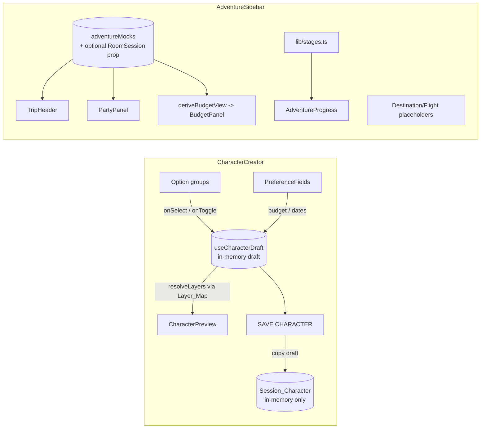

# Design Document

## Overview

The Lobby / Character Creation screen is the interactive SETUP-stage surface of the
PixelArt Trip Planner. It is **frontend-only** and **session-only**: it adds no backend, no
new service, and no persistence. A user builds an 8-bit pixel character from composable
visual layers and sets travel preferences on the left; a persistent "Your Adventure"
sidebar on the right shows trip status, party, budget, and the six-stage quest progression.

This design integrates the feature into the **existing `src/features/party-lobby` feature
module** rather than creating a new top-level feature. Justification:

- `party-lobby` already owns the SETUP-stage surface: `SetupStageContent` renders the room
  code and the live `RosterPanel`, and `PartyRoomShell` wraps everything in the six-stage
  `StageStepper` derived from `room.planningStage`. The character creator and the adventure
  sidebar are the other half of that same SETUP screen.
- `party-lobby/lib/stages.ts` already encodes the authoritative six-stage model and
  `buildStageSteps(planningStage)`. Reusing it keeps a single source of the stage model
  rather than forking a second one.
- An existing placeholder `CharacterCreator.tsx` + `lib/characterOptions.ts` already live
  here with the exact option catalogs this feature needs. This design formalizes and
  upgrades them (notably: a flat sprite box → composable layers; a full adventure sidebar)
  in place, avoiding a parallel feature that would duplicate the room shell.

The feature is purely presentational and local-state driven. It raises events via callbacks
and receives data via props. All visible data is either in-memory React state or
feature-local mock fixtures. No UI component imports a concrete service; where a room code is
surfaced, it comes from an already-resolved `RoomSession` passed in as a prop (obtained by
the room shell through the existing `getServices()` boundary — this feature adds no new
data access).

### Design Goals

- A large, immediately-updating **composable layered** character preview, data-driven so new
  art slots in without touching the preview component.
- Clean composition into the existing party-lobby room shell as the SETUP left panel + right
  sidebar, with no change to any later stage.
- Honest UI: destination/flight are empty states; "save" is explicitly session-only.
- Strict adherence to the pixel design system (named theme tokens only) and the frontend
  architecture (feature structure, shared primitives, no concrete service imports in UI).

### Key Constraints (carried from requirements)

- **No persistence**: no Supabase, `localStorage`, `sessionStorage`, cookies, or IndexedDB.
- **No backend / no new service / no `api-contracts.md` change.**
- **No later-stage behavior**: DISCOVER → WRAP, voting, feedback, export, AI/chat excluded.
- **No shared contract type change**: the feature's draft/session model is feature-local and
types in `src/types`. The `SessionCharacter` is shaped to match the backend request payload
1:1 (see the example payload), so a future real service can pass it straight through without
remapping; nothing here is persisted or sent while this feature is in-memory only.
## Architecture

### Placement in `src/features/party-lobby`

```
src/features/party-lobby/
  components/
    # existing (unchanged by this feature except composition wiring):
    PartyRoomShell.tsx        # six-stage shell; SETUP renders setup content
    SetupStageContent.tsx     # SETUP content host — composes the new left+right
    RosterPanel.tsx
    StageStepper.tsx
    ...
    # new in this feature:
    CharacterCreator.tsx      # (upgraded) left panel: preview + option groups + prefs + save
    CharacterPreview.tsx      # large composable layered avatar
    OptionCardGroup.tsx       # single-select pixel-card group (archetype/outfit/accessory/style)
    OptionTagGroup.tsx        # multi-select pixel-tag group (interests/activities)
    PreferenceFields.tsx      # budget + availability date inputs
    AdventureSidebar.tsx      # right panel container + mobile drawer
    SidebarTripHeader.tsx     # trip name + dates
    SidebarPartyPanel.tsx     # member sprites + empty slots + invite affordance
    SidebarPlaceholderPanel.tsx # destination / flight "Not selected"
    BudgetPanel.tsx           # limit / estimated / remaining + over-budget contract
    AdventureProgress.tsx     # six-stage quest stepper (reuses lib/stages.ts)
  hooks/
    useCharacterDraft.ts      # draft reducer + save-to-session (in-memory only)
    useAdventureDrawer.ts     # mobile drawer open/close state
  lib/
    characterOptions.ts       # (existing) option catalogs
    characterLayers.ts        # NEW: Layer_Map + resolveLayers() (data-driven)
    budget.ts                 # NEW: deriveBudgetView() incl. over-budget
    adventureMocks.ts         # NEW: feature-local mock trip/party/budget fixtures
    stages.ts                 # (existing) six-stage model, reused by AdventureProgress
  types.ts                    # NEW/extended: feature-local CharacterDraft, layer + sidebar types
```

Rationale: feature-local UI, hooks, lib, and types stay inside the feature per
`frontend-architecture.md`. Shared primitives are imported from `@/components`. Mock data is
feature-local (`lib/adventureMocks.ts`) because the architecture's `src/mocks` is reserved
for the mock *service* implementations; this feature uses no service, so its fixtures live
with the feature.

### Shared primitive extension: `CharacterSprite`

`CharacterSprite` today is a single token-styled box keyed by `spriteKey`. This feature
requires composable layers. The sprite primitive is **extended, not forked**:

- Add an optional `layers?: readonly SpriteLayer[]` prop to `CharacterSprite`. When provided,
  the primitive stacks the layers (absolutely-positioned, pixelated, integer-scaled); when
  omitted, it renders exactly as today (single box keyed by `spriteKey`), preserving all
  existing call sites (e.g. roster sprites) unchanged.
- The existing props (`spriteKey`, `label`, `decorative`, `size`) are preserved. Decorative
  usage keeps `aria-hidden`; labelled usage keeps `role="img"` + `aria-label`.
- `CharacterPreview` composes the extended `CharacterSprite` with resolved layers; small
  party sprites keep using the simple single-key form.

This keeps the layered capability in the shared design system (so later stages/party room can
reuse it) while leaving the current contract backward compatible.

### Composition into the room shell and the future Party Room

- `SetupStageContent` composes `CharacterCreator` (left) and `AdventureSidebar` (right) into a
  two-column layout. On mobile the sidebar becomes a drawer.
- `AdventureProgress` is driven by `buildStageSteps(room.planningStage)` from the existing
  `lib/stages.ts`; with the room in SETUP it shows SETUP active and the rest upcoming. No
  later-stage view is redesigned — those stages continue to render the existing honest
  `StagePlaceholder`.
- The `Session_Character` lives in SETUP-local state for this session. The future Party Room /
  NPC chatbot can later read a saved character via a real service, but that integration is out
  of scope here and requires no change to this feature's component API (the save handler is a
  single seam).

### Data flow



No arrow crosses into Supabase, FastAPI, or browser storage. The only external datum is an
optional, already-resolved `RoomSession` passed as a prop for the invite room code.

## Components and Interfaces

All components are presentational: data in via props, events out via callbacks. Types shown
are the feature-local interfaces (full definitions in **Data Models**). Styling uses named
theme tokens only.

### `CharacterPreview`

- **Props:** `{ layers: readonly SpriteLayer[]; label: string }`
- Renders the large avatar by passing `layers` to the extended `CharacterSprite` (size `lg`).
- Decorative to assistive tech (`decorative` / `aria-hidden`); the surrounding region carries
  any needed text. Re-renders whenever `layers` changes.

### `OptionCardGroup` (single-select)

- **Props:** `{ legend: string; options: readonly CharacterOption[]; selectedId: string | null;
  onSelect: (id: string) => void }`
- Renders a `fieldset`/`legend` with one `PixelButton` (`variant="option"`) per option.
  `ariaPressed = selectedId === option.id`. Used for Archetype, Outfit, Accessory, Palette,
  and Travel Style.

### `OptionTagGroup` (multi-select)

- **Props:** `{ legend: string; options: readonly CharacterOption[]; selectedIds: readonly
  string[]; onToggle: (id: string) => void }`
- Same structure; `ariaPressed = selectedIds.includes(option.id)`. Used for Interests and
  Destinations.

### `ActivityPriorityGroup` (multi-select with priority)

- **Props:** `{ legend: string; options: readonly CharacterOption[]; selected: readonly
  ActivityDraft[]; onToggle: (name: string) => void; onPriorityChange: (name: string,
  priority: "must_have" | "optional") => void }`
- Toggles each activity on/off like `OptionTagGroup`; when an activity is selected, exposes a
  must_have / optional control per activity (a two-state `PixelButton` pair with `ariaPressed`),
  producing `ActivityDraft` objects `{ name, priority }`.

### `PreferenceFields`

- **Props:** `{ budgetText; onBudgetChange; origin; onOriginChange; hardConstraints;
  onAddConstraint; onRemoveConstraint; availableDates; onDateRangeChange: (index, range) =>
  void; onAddDateRange; onRemoveDateRange }`
- Numeric budget input (label "ADVENTURE FUNDS", placeholder "1500"), an "ORIGIN" text input
  (placeholder "SIN"), a repeatable "HARD CONSTRAINTS" list (add/remove free-text lines, e.g.
  "no red-eye flights"), and one or more availability ranges, each a pair of "Available From" /
  "Available Until" `type="date"` inputs. Every control has a programmatic `<label htmlFor>`.
  Conventional readable styling.

### `CharacterCreator` (left panel host)

- **Props:** `{ viewerDisplayName: string }`
- Owns `useCharacterDraft`. Renders heading "CREATE YOUR CHARACTER", subtitle "Build your
  traveller for the adventure.", `CharacterPreview`, five `OptionCardGroup`s (Archetype,
  Outfit, Accessory, Palette, Travel Style), `OptionTagGroup`s (Interests, Destinations),
  `ActivityPriorityGroup` (Activities), `PreferenceFields`, and the primary "SAVE CHARACTER"
  `PixelButton`.
- Save is disabled until archetype, outfit, and accessory are all chosen. On save it projects
  the draft into the payload-shaped session character and shows a polite-live-region status:
  session-only / not persisted.

### `AdventureSidebar` (right panel host)

- **Props:** `{ adventure: AdventureView; roomSession?: RoomSession | null }`
- Desktop: fixed right column. Mobile: a collapsible drawer via `useAdventureDrawer`, with a
  toggle button exposing `aria-expanded`. Composes `SidebarTripHeader`, `SidebarPartyPanel`,
  two `SidebarPlaceholderPanel`s (Destination, Flight), `BudgetPanel`, and
  `AdventureProgress`.

### `SidebarTripHeader`

- **Props:** `{ tripName: string; dateRangeLabel: string }` — e.g. "JAPAN ADVENTURE",
  "12 Dec → 20 Dec". Readable date text.

### `SidebarPartyPanel`

- **Props:** `{ members: readonly PartyMemberView[]; capacity: number; roomCode: string |
  null; onInvite: () => void }`
- Renders each member as a small `CharacterSprite` (decorative) + name label; fills remaining
  `capacity - members.length` positions as empty slots. "INVITE MEMBERS" `PixelButton`
  surfaces `roomCode` when present, else a placeholder. `onInvite` performs no network call.

### `SidebarPlaceholderPanel`

- **Props:** `{ title: string; emptyLabel: string }` — renders "Not selected" display-only.
  Used for Destination and Flight.

### `BudgetPanel`

- **Props:** `{ budget: BudgetView }` where `BudgetView` is produced by `deriveBudgetView`.
- Shows limit, estimated, remaining. When `isOverBudget`, shows the overage and an "OVER
  BUDGET" label using a `danger` status token plus text (never color alone).

### `AdventureProgress`

- **Props:** `{ steps: readonly StageStep[] }` from `buildStageSteps(planningStage)`.
- Renders the six stages in order; the active stage carries a text/structural indicator in
  addition to a theme color.

### Hooks

- `useCharacterDraft(): { draft, select, toggle, setBudgetText, setOrigin, addConstraint,
  removeConstraint, setDateRange, addDateRange, removeDateRange, toggleActivity,
  setActivityPriority, canSave, sessionCharacter, save }` — a `useReducer` over the draft plus
  an in-memory `sessionCharacter`. `save()` is the single persistence seam; it only projects
  the draft into the payload-shaped `sessionCharacter` in state (no storage, no fetch).
- `useAdventureDrawer(): { isOpen, toggle }` — mobile drawer state, defaulting closed on
  mobile.

## Data Models

All models are **feature-local** (`party-lobby/types.ts`). They do not modify shared contract
types in `src/types`. They stay compatible *in spirit* with `Character` and
`TravelPreferences` so a real service could later map between them.

```ts
// A single stacked visual layer for the composable avatar.
export type SpriteLayerSlot = "base" | "archetype" | "outfit" | "accessory";

export interface SpriteLayer {
  slot: SpriteLayerSlot;
  /** Z-order; lower renders behind higher. */
  order: number;
  /** Asset key resolved to a pixel visual by the renderer. */
  assetKey: string;
}

// Data-driven mapping: selection id -> the layer it contributes, per slot.
export interface LayerMapEntry {
  slot: SpriteLayerSlot;
  order: number;
  assetKey: string;
}
export type LayerMap = Readonly<Record<SpriteLayerSlot, Readonly<Record<string, LayerMapEntry>>>>;

// The in-memory, not-yet-saved selection set (left panel).
export interface ActivityDraft {
  name: string;
  priority: "must_have" | "optional";
}
export interface DateRange {
  start: string; // ISO 8601 (YYYY-MM-DD)
  end: string;   // ISO 8601 (YYYY-MM-DD)
}
export interface CharacterDraft {
  // Appearance selections.
  archetype: string | null;
  outfit: string | null;
  accessory: string | null;
  palette: string | null;
  // Travel preferences.
  travelStyle: string | null;
  destinations: readonly string[];
  interests: readonly string[];
  activities: readonly ActivityDraft[];
  hardConstraints: readonly string[];
  origin: string;
  /** Raw input text; parsed to a number for the model. */
  budgetText: string;
  /** One or more availability ranges; UI starts with a single range. */
  availableDates: readonly DateRange[];
}

// The saved, session-only character. Shaped to match the request payload 1:1 so a
// future service can pass it straight through (still never persisted here).
export interface SessionCharacterAppearance {
  accessory: string;
  outfit: string;
  palette: string;
}
export interface SessionCharacter {
  availableDates: readonly DateRange[];
  destinations: readonly string[];
  travelStyle: string | null;
  budget: number | null;
  interests: readonly string[];
  activities: readonly ActivityDraft[];
  hardConstraints: readonly string[];
  origin: string;
  character: {
    appearance: SessionCharacterAppearance;
    spriteKey: string;
  };
}

// Sidebar view models (from feature-local mock + optional RoomSession).
export interface PartyMemberView {
  id: string;
  displayName: string;
  archetypeLabel: string;
  spriteKey: string;
}
export interface BudgetView {
  limit: number;
  estimated: number;
  remaining: number;      // limit - estimated (may be negative)
  isOverBudget: boolean;  // estimated > limit
  overageAmount: number;  // max(0, estimated - limit)
}
export interface AdventureView {
  tripName: string;
  dateRangeLabel: string;
  members: readonly PartyMemberView[];
  capacity: number;
  budget: BudgetView;
}
```

### Request payload shape (target)

`SessionCharacter` mirrors the request body the frontend will eventually POST (no call is made
in this feature). `toSessionCharacter` produces exactly this shape:

```json
{
  "availableDates": [{ "start": "2026-12-20", "end": "2026-12-27" }],
  "destinations": ["Tokyo"],
  "travelStyle": "relaxed",
  "budget": 1500,
  "interests": ["food", "museums"],
  "activities": [
    { "name": "hiking", "priority": "must_have" },
    { "name": "spa", "priority": "optional" }
  ],
  "hardConstraints": ["no red-eye flights"],
  "origin": "SIN",
  "character": {
    "appearance": { "accessory": "backpack", "outfit": "explorer", "palette": "forest" },
    "spriteKey": "explorer-01"
  }
}
```

### Pure logic functions (`lib`)

- `resolveLayers(draft: CharacterDraft, map: LayerMap): readonly SpriteLayer[]` — always
  includes the base layer, then adds the archetype/outfit/accessory layers for whichever
  selections are set, sorted ascending by `order`. New assets are added purely by extending
  the `LayerMap`; the function and `CharacterPreview` are untouched.
- `deriveBudgetView(limit: number, estimated: number): BudgetView` — computes remaining,
  `isOverBudget`, and `overageAmount`.
- `toSessionCharacter(draft): SessionCharacter | null` — returns `null` unless the
  archetype, outfit, and accessory are set; otherwise projects the draft into the request
  payload shape: parses budget text to a number (or `null`), copies `availableDates`,
  `destinations`, `interests`, `activities` (name + priority), `hardConstraints`,
  `origin`, and `travelStyle`, and builds `character.appearance` (`accessory`/
  `outfit`/`palette`) plus a derived `spriteKey`.
- `deriveSpriteKey(appearance): string` — derives the `spriteKey` (e.g. an archetype-based
  key such as `explorer-01`) from the appearance selections; pure and deterministic.

### Layer mapping (data-driven, extensible)

`characterLayers.ts` holds the `LayerMap`: for each slot (`base`, `archetype`, `outfit`,
`accessory`) a record from selection id → `{ slot, order, assetKey }`. The base slot has a
single always-present entry. Adding a new archetype/outfit/accessory asset = adding one entry
to the map; no component changes. `order` values keep base behind archetype behind outfit
behind accessory.

## Error Handling

This feature has no network, no I/O, and no persistence, so there are no fetch, storage, or
backend error paths to handle. Error handling is confined to local input validation and safe
rendering:

- **Invalid or empty budget text.** `toSessionCharacter` parses the budget text; empty,
  whitespace-only, or non-finite input resolves to a `budget` of `null` rather than throwing.
  The numeric input uses `min=0`; negative or non-numeric entries resolve to `null`.
- **Incomplete draft on save.** The "SAVE CHARACTER" control is disabled while `canSave` is
  false (archetype, outfit, or accessory missing). An explanatory line tells the user which
  selections are still required, so save never runs on an incomplete draft.
- **Missing room session for invite.** When no `RoomSession` prop is provided, the invite
  affordance renders a placeholder instead of a room code; no error surfaces and no request
  is attempted.
- **Unknown selection id in the layer map.** `resolveLayers` ignores any selection id with no
  matching `LayerMap` entry (the slot contributes no layer) and still returns the base layer,
  so the preview is never empty and never throws.
- **Mobile drawer state.** Drawer open/close is local boolean state; there is no failure mode
  beyond toggling, and the toggle keeps `aria-expanded` in sync.

There are no silent failures: the save status is announced through a polite live region, and
disabled/placeholder states are visible and labelled.
