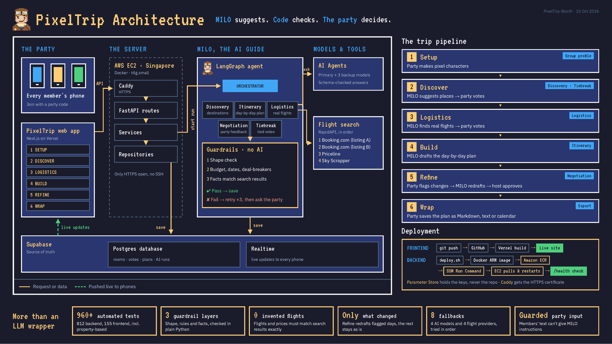

# PixelTrip

An AI-powered collaborative travel planning web app with an 8-bit retro RPG theme.
Planning a trip should feel less like filling out forms and more like a party of
adventurers deciding on their next quest together. Group members are a **party**,
planning is a **quest**, the AI is an in-world **NPC** guide, and the final plan is
an **adventure summary**.

There is no account sign-up or sign-in: users enter with a lightweight guest name
and go straight into the experience.

## Architecture

**MILO suggests. Code checks. The party decides.**



- **The party:** every member joins from their phone with a party code and moves through
  six stages in the Next.js web app (hosted on Vercel): Setup, Discover, Logistics,
  Build, Refine and Wrap.
- **The server:** a FastAPI backend in Docker on one AWS EC2 `t4g.small` in Singapore,
  behind Caddy for HTTPS. Requests go through routes, then services, then repositories.
  Only HTTPS is open; there is no SSH.
- **MILO, the AI guide:** a LangGraph agent. An orchestrator sends work to the Discovery,
  Itinerary, Logistics, Negotiation and Tiebreak nodes. Every answer passes plain-Python
  guardrails (shape check, then budget, dates and deal-breakers, then facts that must match
  search results) before it is saved. If an answer fails, MILO retries up to 3 times and
  then asks the party.
- **Models and tools:** a primary LLM with 3 backup models, all answers schema-checked;
  real flights from RapidAPI providers tried in order (Booking.com ×2, Priceline,
  Sky Scrapper).
- **Supabase:** the source of truth. Postgres holds rooms, votes, plans and AI runs, and
  Realtime pushes live updates to every phone.

| Stage | What happens | MILO node |
|---|---|---|
| 1 Setup | Party makes pixel characters | Group profile |
| 2 Discover | MILO suggests places, party votes | Discovery, Tiebreak |
| 3 Logistics | MILO finds real flights, party votes | Logistics |
| 4 Build | MILO drafts the day-by-day plan | Itinerary |
| 5 Refine | Party flags changes, MILO redrafts, host approves | Negotiation |
| 6 Wrap | Party saves the plan as Markdown, text or calendar | Export |

A PDF version is at [`docs/images/architecture.pdf`](./docs/images/architecture.pdf), and
the written reference is [`docs/architecture.md`](./docs/architecture.md).

## Monorepo Layout

This repository is a monorepo with three independently deployable parts:

```
.
├── frontend/   # Next.js (App Router) + React + TypeScript + Tailwind app
├── backend/    # FastAPI + LangGraph agent (MILO), guardrails, flight search
├── supabase/   # database migrations
├── deploy/     # AWS scripts: setup, push settings, build and deploy
└── docs/       # shared documentation
```

The frontend and backend share nothing at runtime except the agreed HTTP contract
described in `.kiro/steering/api-contracts.md` (the single source of truth). This
keeps both parts independently deployable so the team can work in parallel.

## Run Locally

The quickest way to run both parts is the local runner:

```bash
./run-local.sh              # backend (:8000) + frontend (:3000), mock services
./run-local.sh --real       # frontend talks to the real backend
./run-local.sh --check      # pytest, tsc, vitest and ruff, then exit
```

To run each part by hand, follow the two sections below.

## Run the Frontend

The frontend is a Next.js App Router application under `frontend/`. It develops
against mock services by default, so it runs with no backend present.

```bash
cd frontend
cp .env.example .env.local   # then fill in placeholder values
npm install
npm run dev
```

The dev server starts on http://localhost:3000. Service selection is controlled by
`NEXT_PUBLIC_SERVICE_MODE` (`mock` by default, `real` for backend integration).

## Run the Backend

The backend is a FastAPI application under `backend/`. It runs standalone with no
frontend present and exposes a `GET /health` check.

```bash
cd backend
cp .env.example .env         # then fill in placeholder values
python -m venv .venv
# Windows:  .venv\Scripts\activate
# Unix:     source .venv/bin/activate
pip install -e .             # or: pip install -r requirements.txt
uvicorn app.main:app --reload
```

The server starts on http://localhost:8000. Verify it with `GET /health`, which
returns `{"status": "ok"}`.

## Deploy

- **Frontend:** `git push` to GitHub, and Vercel builds and publishes the live site.
- **Backend:** `./deploy/deploy.sh` builds an ARM Docker image, pushes it to Amazon ECR,
  and tells the EC2 server to pull and restart it through SSM Run Command. It finishes by
  checking `/health`.

Keys live in AWS Parameter Store, never in the repo, and Caddy gets the HTTPS
certificate. See [`docs/deployment.md`](./docs/deployment.md) for first-time setup.

## Documentation

See [`docs/`](./docs) for the documentation index, architecture reference,
getting-started guide, and contracts reference.

For the prepared **DemoAlice / DemoBob** two-device walkthrough, see
[`docs/PREPARED_DEMO.md`](./docs/PREPARED_DEMO.md). Apply its database migration before
deploying the demo code; ordinary rooms continue to use the live planner.
